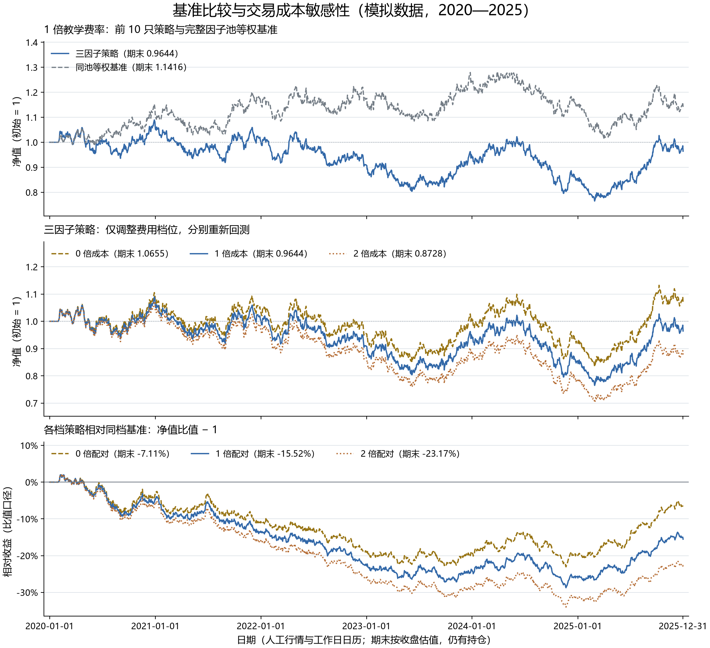
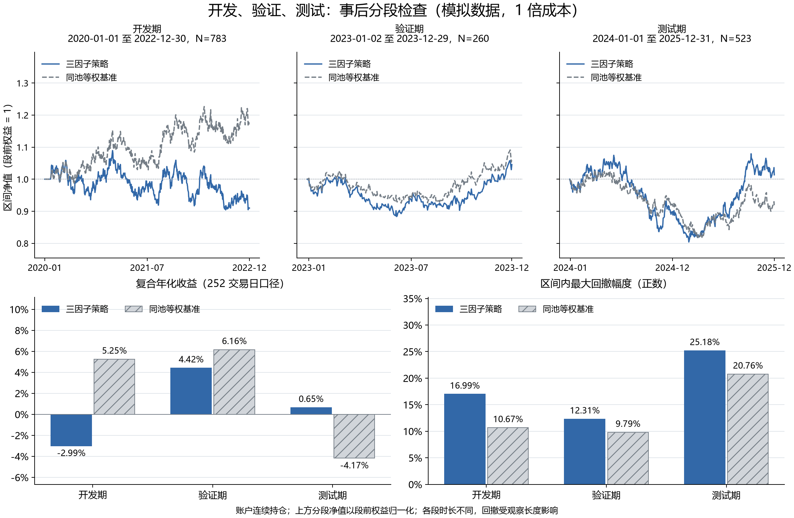
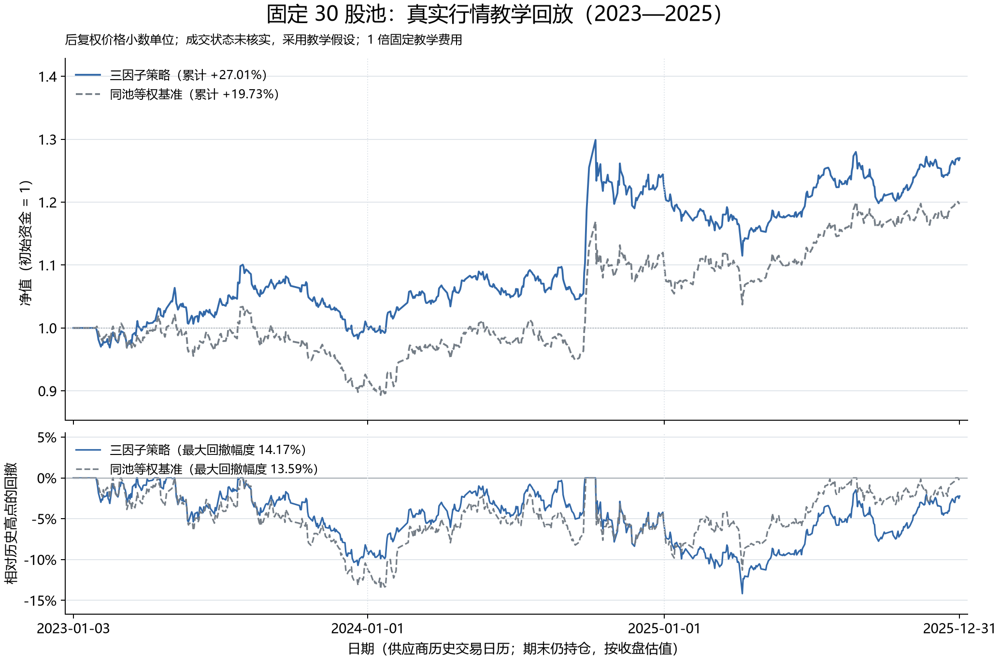

# 教学闭环已跑通，策略有效性仍需进一步验证

我在这份总览中整理 19 课参考实现、输入快照和已运行结果。行情观察截止 2025-12-31；本次交付校验时间为 2026-11-07T13:11:47.711023+00:00。

## 报告摘要

- 模拟数据验证了完整工程流程，三因子策略累计收益约 −3.56%，同池基准约 +14.16%。无费策略也落后于同档无费基准，不能把差距全部归因于费用。
- 固定 30 股真实行情教学回放在 2023—2025 年累计收益约 +27.01%，同池基准约 +19.73%；2025 年策略落后于基准。成交状态未核实、固定样本偏差等限制仍然影响结果解释。
- 第 01-18 课脚本、两类数据、SQL、研究表、账户记录和报告已保留；35 项核心测试通过。程序与交付可复现不等于因子有效、实盘可成交或学习者已独立掌握。

## 交付入口

先读 [19 课复现与交付指南](06_19课复现与交付指南.md)，再使用 [第 19 课入口](../examples/19_finalize_project.py)。

- [真实行情完整研究报告](../runs/lesson18_real_market/experiment/report.html)
- [模拟完整研究报告](../runs/first_demo_20261107/report.html)
- [本次校验记录](../runs/lesson19_delivery/verification.json)、[测试日志](../runs/lesson19_delivery/tests.log)、[环境记录](../runs/lesson19_delivery/environment.json)
- [文件哈希清单](../runs/lesson19_delivery/project_manifest.json)

## 我搭建了什么

流水线为：输入快照与数据检查 → 20 日动量、20 日日收益波动、5/20 日均量比 → 截面 MAD 去极值与标准化 → 三因子等权合成 → 月末选前 10 → 次交易日开盘执行 → 每日现金与持仓估值 → IC、分组和绩效报告。

动量方向为 +1，波动和活跃度方向为 −1。方向和等权规则是预设假设。理论标签/IC/分组收益用于事后因子检验；账户净值另行模拟成交、费用和现金，两类结果不能混为一谈。

手续费为单边佣金 3 bps、滑点 5 bps、卖出税 5 bps 的固定教学参数。数量是复权价格下的小数单位；买入前隔夜变化不归新仓所有，已有仓位继续承担隔夜变化。受限卖出保留旧仓，买入按可用现金缩放，拒单不在次日自动重试。期末仍持仓，按收盘估值。

## 模拟实验：工程跑通不代表策略跑赢

本部分为 40 只人工股票，2020—2025 年。日历仅为工作日，包含真实市场假日；不作 A 股市场实证结论。

| 组合（1 倍成本） | 累计收益 | 252 日年化 | 年化波动 | 最大回撤幅度 |
| --- | --- | --- | --- | --- |
| 三因子策略 | -3.5632% | -0.5822% | 13.6014% | 29.7750% |
| 同池等权基准 | +14.1581% | +2.1537% | 12.7301% | 20.7582% |

同档费用同时作用于策略和基准。成本敏感性分别重新模拟账户，而非从无费终值机械扣除累计费用：

| 费用倍数 | 策略累计收益 | 同档基准累计收益 | 策略账面成本（元） |
| --- | --- | --- | --- |
| 0 | +6.5523% | +14.7084% | 0.00 |
| 1 | -3.5632% | +14.1581% | 93,205.42 |
| 2 | -12.7163% | +13.6113% | 177,673.63 |

来源：[第 16 课指标](../runs/first_demo_20261107/lesson16_benchmark_cost/metrics.csv)、[同档相对比较](../runs/first_demo_20261107/lesson16_benchmark_cost/relative_comparison.csv)、[成本路径对照](../runs/first_demo_20261107/lesson16_benchmark_cost/cost_impact.csv)。收益差采用百分点；比值相对收益为策略净值/基准净值−1，二者分母不同。

## 分段检查：测试期领先尚不足以说明跨期稳定

| 区间 | 日数 | 策略累计收益 | 基准累计收益 | 比值相对收益 |
| --- | --- | --- | --- | --- |
| 开发期 | 783 | -9.0084% | +17.2420% | -22.3899% |
| 验证期 | 260 | +4.5637% | +6.3639% | -1.6926% |
| 测试期 | 523 | +1.3586% | -8.4561% | +10.7213% |

账户跨段连续持仓，分段净值以首条日收益之前的权益为 1，保留首日损益。各段增长倍数连乘可以还原全期收益；费用可以求和；最大回撤须在完整路径上重算。

三个区间时长不同，收益比较同时看年化、风险与曲线，回撤受观察长度影响。完整历史已经展示过，本次是事后分段检查，不能把 test 标签解释成一次新的未见样本外检验。来源：[第 17 课分段指标](../runs/first_demo_20261107/lesson17_split_stability/metrics.csv)、[边界权益](../runs/first_demo_20261107/lesson17_split_stability/boundaries.csv)、[跨段核对](../runs/first_demo_20261107/lesson17_split_stability/reconciliation.csv)。

## 真实行情：固定股票池与假设成交下的回放

| 组合（1 倍成本） | 累计收益 | 252 日年化 | 年化波动 | 最大回撤幅度 |
| --- | --- | --- | --- | --- |
| 三因子策略 | +27.0063% | +8.6398% | 11.7409% | 14.1726% |
| 同池等权基准 | +19.7282% | +6.4401% | 12.3023% | 13.5898% |

| 既定区间 | 策略累计收益 | 基准累计收益 | 比值相对收益 |
| --- | --- | --- | --- |
| 2023 开发 | +1.0439% | -7.3955% | +9.1134% |
| 2024 验证 | +21.6097% | +19.6653% | +1.6248% |
| 2025 测试 | +3.3587% | +8.0429% | -4.3355% |

来源：[真实策略与基准指标](../runs/lesson18_real_market/strategy_benchmark_metrics.csv)、[方法说明](../runs/lesson18_real_market/methodology.json)、[完整流水线](../runs/lesson18_real_market/experiment/report.html)。这一回放使用已查看的快照，尚不能声称新的未见测试。

快照有 50,927 条价格、30 只手工固定股票及 1,699 个来源日历交易日。完整固定网格缺 43 条，其中按现有 eligible 定义缺 37 条；该定义以首条可见行情起算，不是核实后的上市资格。2023—2025 年为 727 个交易日、21,810 条行情，区间缺口为零。研究区间 21,810 行历史成交状态均未知。

2020—2025 年真实运行曾在持有 600009 的 2021-06-10 缺价时停止，见[失败记录](../runs/failed_2020_2025.json)。当前沿用此前按覆盖检查冻结的 2023—2025 年教学区间，更早的缺口仍保留，未伪造估值或删除股票。来源：[质量检查](../runs/lesson18_real_market/data_quality.json)、[逐年覆盖](../runs/lesson18_real_market/yearly_coverage.csv)、[原始文件哈希核对](../runs/lesson18_real_market/source_hash_checks.csv)。

## 验收与适用范围

我在本次验证中检查了核心测试、两类输入快照、14 条主要账户路径的现金与持仓恒等式、收益连乘、费用汇总、成交晚于信号、三段收益复原以及本地文档链接。详细证据位于[校验记录](../runs/lesson19_delivery/verification.json)。原始/规范化数据及代码、配置、报告的文件哈希保存在[清单](../runs/lesson19_delivery/project_manifest.json)；清单自身不作自引用哈希。

仍待后续研究补齐的事项：历史动态股票池、退市/ST/IPO 资格、真实停复牌与开盘涨跌停状态、企业行动现金账、整手与最低佣金、容量和冲击、历史税费变化，以及新的未使用时期检验。固定 30 股存在选择与幸存者偏差。文献综述、完整实证论文和实盘验证不属于本教学交付已完成的范围。

我应能独立解释一只股票、一个因子、一个 IC、一次调仓、一次分段与一份报告。对应练习和验收题见[复现指南](06_19课复现与交付指南.md)及[答辩自查](04_答辩与自查.md)。
