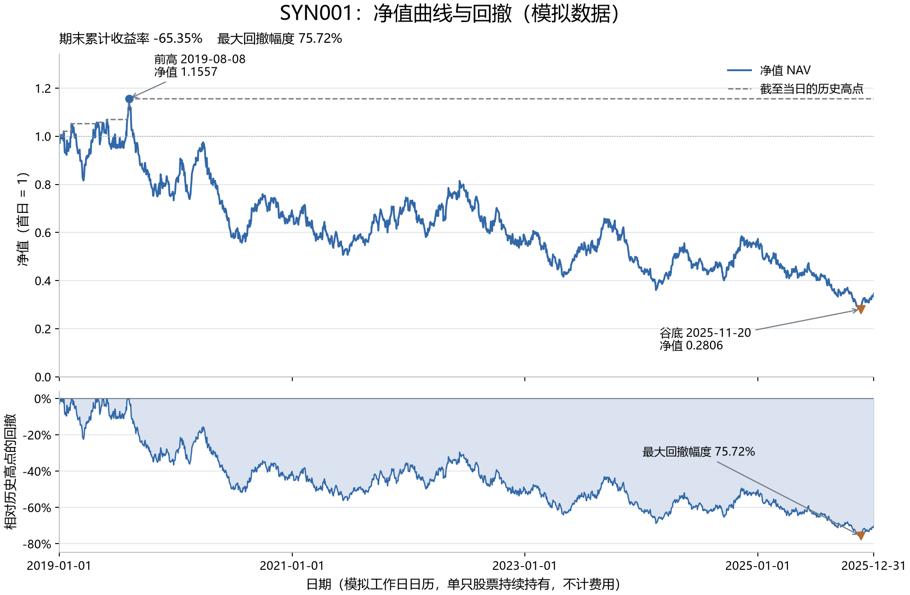

# 第 04 步：净值、回撤与最深下跌区间

<!-- SNAPSHOT_NOTE -->
## 数据准备

本页记录的是完整快照上的实际运行。从 GitHub 克隆源码后，先在仓库根目录运行 `python publication/restore_snapshot.py`，恢复同版本的 `data/` 与 `runs/`，再执行本步。[完整数据与大型结果索引](../../publication/ASSET_INDEX.md)保留全部路径和哈希；本页图表与 Notebook 已保存输出可直接阅读。


## 目标与范围

上一节得到的期末累计收益只是一个终点数字，无法说明持有过程中的损失体验。本步继续观察 `SYN001` 的同一条人工价格路径，计算截至每日的历史高点、每日回撤和最大回撤，再把对应的峰值与谷值放回时间轴。

前提仍是首日收盘净值设为 1、单股持续持有、没有外部现金流和交易费用。这里不是多因子策略回测，也没有按照图上的峰谷提前买卖。事后图表用于描述已经发生的路径，不能将事后才知道的最低点当成当时可用的交易信号。

完成 [第 03 步](../03_cumulative_returns/README.md)，并安装 `.[plots]` 后，在仓库根目录执行：

```powershell
.\.venv\Scripts\python.exe examples/04_nav_drawdown.py
```

脚本读取固定人工输入，保存图到 `runs/first_demo_20261107/figures/SYN001_nav_drawdown.png`。本节引用的是该现成图，不使用其他股票或另造一条曲线。

## 回撤公式与符号约定

设 `N_t` 为第 t 日净值，截至当日的历史最高净值为：

$$
H_t=\max_{0\le s\le t}N_s.
$$

每日带符号回撤为：

$$
D_t=\frac{N_t}{H_t}-1\le0.
$$

最大回撤的带符号值写成 `min(D_t)`，便于展示的最大回撤幅度写成 `-min(D_t)`。前者是负数或零，后者是正数或零。若一条净值从 1.2 跌到 0.9，回撤为 `0.9/1.2-1=-25%`，不是相对最初资金的 -10%。这是说明公式的算术例子，不是当前样本的峰谷数值。

不能对全历史用 `nav.max()` 只求一个最高点，再让每一天都除以它。那会把尚未出现的未来高点放进早期日期，使早期回撤失去“截至当时”的定义。最低净值除以最高净值也不能直接当作最大回撤，因为全局最低点可能发生在全局最高点之前。

## 核心代码说明

```python
stock["running_peak"] = stock["nav"].cummax(skipna=False)
stock["drawdown"] = stock["nav"] / stock["running_peak"] - 1
max_drawdown_signed = stock["drawdown"].min()
max_drawdown = -max_drawdown_signed
```

`cummax` 在每一行只使用当前及此前的净值，得到一条不会下降的高水位线。`skipna=False` 明确要求遇到中途缺失后不再继续拼接路径；本脚本已先要求价格完整且为正。第二行将当前净值与同一日期的高水位比较。第三行找最负的回撤；第四行转换为正幅度，便于图标题和文字展示。

`max_drawdown` 衡量从前高下跌的幅度，不能直接解释为起点到终点的回报。后续核心绩效表里的 `max_drawdown` 使用负数口径，因此跨文件比较时需要先看字段说明，不能只看同名字段便假定符号一致。

```python
trough_index = stock["drawdown"].idxmin()
peak_index = stock.loc[:trough_index, "nav"].idxmax()
peak = stock.loc[peak_index]
trough = stock.loc[trough_index]
```

`idxmin()` 返回最深回撤所在的行标签，而不是回撤数值。此前重排过索引，因此当前标签与行顺序一致。第二行先截取谷底及之前的区间，再寻找其中最高净值，确保峰值在谷底之前。`.loc[:trough_index]` 包含端点。若最深回撤或高点有并列，当前 pandas 选择第一次出现的位置；峰谷日期的解释也沿用这一确定规则。

## 实际数值与峰谷顺序

| 核对指标 | 当前人工样本结果 |
| --- | ---: |
| 起点日期 | 2019-01-01 |
| 期末日期 | 2025-12-31 |
| 期末净值 | 0.3465317571 |
| 期末累计收益 | -65.346824% |
| 最大回撤带符号值 | -0.7572110610 |
| 最大回撤幅度 | 75.721106% |
| 对应前高日期 | 2019-08-08 |
| 对应前高净值 | 1.1557040013 |
| 对应谷底日期 | 2025-11-20 |
| 对应谷底净值 | 0.2805921483 |

用价格比复算：`0.2805921483/1.1557040013-1≈-0.7572110610`，与表中结果一致。期末累计亏损约 65.35%，而最大回撤约 75.72%，两者不相等，原因是参照点不同：前者相对首日净值 1，后者相对之前达到的高点。

当前期末回撤约为 **-70.01552675%**，也不是最深回撤。谷底之后出现了一定恢复，但期末仍明显低于过去高点。因此要分别保留“期末表现”和“历史最差路径”，不能用后来的反弹抹去先前的下跌。

开头几个日期也可以逐行核对：首日 `NAV=1`、历史高点 1、回撤 0；2019-01-02 净值约 0.9706366333，回撤约 -2.936337%；2019-01-03 净值约 1.0031889131，创新高，所以回撤回到 0。2019-01-07 的净值虽然仍接近起点，但低于 01-04 的前高，回撤约 -1.584982%。这些小例子能够检查 `cummax` 和除法方向是否正确。

## 图表阅读



上图的实线是净值，虚线是截至当日的历史高点，下图是带负号的回撤。两个子图共用日期轴，所以可以把上方某段净值下跌与下方回撤加深对应起来。水平参考线 1 代表起点财富，不代表每次重新建仓；下方的 0 代表处于历史高点，而不是价格没有波动。

图上标注峰值和谷值是为定位本次最大回撤，不是投资建议。这里计算的是日收盘估值路径的回撤，没有使用日内最高价和最低价，因此不能声称覆盖持有期间每一个盘中极端价格。

## 绘图代码的关键设置

```python
matplotlib.use("Agg")
fig, (ax_nav, ax_dd) = plt.subplots(2, 1, sharex=True)
ax_dd.yaxis.set_major_formatter(PercentFormatter(xmax=1.0))
fig.savefig(output_path, dpi=180)
plt.close(fig)
```

`Agg` 让脚本直接生成图片，不依赖交互窗口；它需要在导入 `pyplot` 前设置。`subplots` 创建上下两个坐标轴，`sharex=True` 保持时间轴一致。`PercentFormatter(xmax=1.0)` 告诉图表把原始小数 1 显示为 100%，因此无需提前把回撤乘 100。`savefig` 把画布保存到确定路径，`close` 在保存后释放画布。

脚本还设置中文字体候选；不同系统是否安装这些字体，会影响中文显示。我把字体缺失与金融计算错误分开排查。图片能够生成不代表所有数字就正确，图像标注仍需要与表格核对。

## 路径风险的解释范围

最大回撤是一个路径指标。只知道起点和终点，通常不能还原中间的高水位与下跌过程；即使两份资产的累计收益相同，中间经历的波动和回撤也可能不同。最大回撤又只保留最深的一次幅度，不会完整表达每次下跌的次数、持续时间、恢复速度或收益分布，因此单个数字不能代表“全部风险”。

当前记录给出了前高和谷底，但两者之间的自然日期差不能直接解释为回撤恢复所需的时间。恢复需要净值重新达到原来的高水位；谷底只是最深位置，不是恢复终点。当前期末净值仍低于该高点，所以期末之前的反弹仍不能称为已经恢复。

损失与修复的非对称性可以用一个单独的算术例子解释：财富从一百降到五十，是损失一半；再从五十回到一百，需要在剩余基础上翻倍，而不是上涨一半。这个例子说明回撤幅度必须明确分母，但不能用来预测当前人工股票何时恢复，也不能将最大历史损失视为未来最差损失的上限。

净值基准也应纳入风险计算。若从首个亏损之后才开始取历史高点，可能漏掉一开始相对初始资金的下跌。本节首日净值就是一，并进入 `cummax`；后续真实账户的首次交易成本会使第一笔净值低于初始基准，那时也需要保留初始基准参加回撤核对。风险检查因此不仅关心公式写法，也要明确从哪一天、哪一个资金基数开始使用公式。

## 常见错误与验收

| 错误做法 | 原因 |
| --- | --- |
| 用最差单日收益充当最大回撤 | 单日冲击与多日累计从高点下跌是不同指标 |
| 用全历史最高净值衡量每个早期日期 | 引入未来高点，违背截至当日定义 |
| 忽略峰谷先后顺序 | 可能拼出时间上无法发生的下跌 |
| 给百分数数据再次套用百分比格式 | 图上显示会放大 100 倍 |
| 把最大回撤负号当作计算错误 | 当前程序分别保存带符号值和正幅度 |
| 看到反弹便认为风险已经消失 | 历史最深回撤仍是已经发生的路径事实 |

验收时应确认公式、前几行、峰谷日期和图表四者一致；图中的 75.72% 不是凭视觉估计，而是从保存的净值路径算出。本步结论仍限于人工单股持有序列。下一步进入 [第 05 步](../05_momentum_factor/README.md)，把累计收益的思路改造成每个时点仅回看历史的滚动因子。

<!-- GENERATED_FULL_SOURCE_START -->

## 完整脚本源码

本步完整实现见 [04_nav_drawdown.py](../../examples/04_nav_drawdown.py)。前文解释了关键代码，以下保留与脚本文件一致的完整源码。

```python
"""第四课：绘制单只模拟股票的净值与回撤，计算最大回撤。"""

from pathlib import Path
import pandas as pd
import matplotlib

# 直接保存图片，脚本可以在终端运行。
matplotlib.use("Agg")
import matplotlib.pyplot as plt
import matplotlib.dates as mdates
from matplotlib.ticker import PercentFormatter

# 沿用前几课：读取、筛选、按独立的模拟交易日历对齐。
project_dir = Path(__file__).resolve().parents[1]
data_path = project_dir / "runs" / "first_demo_20261107" / "input" / "prices.csv"
prices = pd.read_csv(data_path, dtype={"symbol": "string"}, parse_dates=["date"])
symbol = "SYN001"
stock = prices.loc[prices["symbol"] == symbol].copy()
stock = stock.sort_values("date").reset_index(drop=True)
calendar = pd.read_csv(data_path.with_name("calendar.csv"), parse_dates=["date"])
stock = stock.set_index("date").reindex(calendar["date"]).reset_index()
if stock.empty or stock["adj_close"].isna().any() or (stock["adj_close"] <= 0).any():
    raise ValueError("本课需要完整且为正的复权收盘价，请先检查股票代码和缺失行情。")

# 1. 本课仍以首日收盘为起点，持续持有这只股票，不计费用。
stock["daily_return"] = stock["adj_close"] / stock["adj_close"].shift(1) - 1
growth_factor = 1 + stock["daily_return"]
growth_factor.iloc[0] = 1.0
stock["nav"] = growth_factor.cumprod(skipna=False)
stock["cumulative_return"] = stock["nav"] - 1

# 2. 截至每一天的历史最高净值；只能用该日及之前的数据。
stock["running_peak"] = stock["nav"].cummax(skipna=False)

# 3. 每日回撤是负数或零；最大回撤幅度以正数展示。
stock["drawdown"] = stock["nav"] / stock["running_peak"] - 1
max_drawdown_signed = stock["drawdown"].min()
max_drawdown = -max_drawdown_signed

# 4. 找到最深回撤的谷底，以及发生在它之前的峰值。
trough_index = stock["drawdown"].idxmin()
peak_index = stock.loc[:trough_index, "nav"].idxmax()
peak = stock.loc[peak_index]
trough = stock.loc[trough_index]
final_return = stock["cumulative_return"].iloc[-1]

# 5. 两幅图共用日期轴，上方净值、下方回撤。
plt.rcParams["font.sans-serif"] = ["Microsoft YaHei", "SimHei", "DejaVu Sans"]
plt.rcParams["axes.unicode_minus"] = False
plt.rcParams["font.size"] = 11
fig, (ax_nav, ax_dd) = plt.subplots(
    2, 1, figsize=(11, 7.2), sharex=True,
    gridspec_kw={"height_ratios": [2, 1]}, layout="constrained",
)
fig.suptitle(f"{symbol}：净值曲线与回撤（模拟数据）", fontsize=17)
ax_nav.set_title(
    f"期末累计收益率 {final_return:.2%}    最大回撤幅度 {max_drawdown:.2%}",
    loc="left", fontsize=11, pad=10,
)

# 6. 净值实线与截至当日的历史高点虚线。
ax_nav.plot(stock["date"], stock["nav"], color="#3268A8", linewidth=1.6, label="净值 NAV")
ax_nav.plot(stock["date"], stock["running_peak"], color="#747D86", linewidth=1.2,
            linestyle="--", label="截至当日的历史高点")
ax_nav.axhline(1.0, color="#9FA6AD", linewidth=0.8, linestyle=":")
ax_nav.set_ylabel("净值（首日 = 1）")
ax_nav.set_ylim(0, max(1.25, stock["nav"].max() * 1.16))
ax_nav.legend(loc="upper right", frameon=False, fontsize=10)

# 峰值和谷值标记，仅用于定位本次最大回撤。
ax_nav.scatter(peak["date"], peak["nav"], color="#3268A8", marker="o", s=40, zorder=5)
ax_nav.scatter(trough["date"], trough["nav"], color="#B46A31", marker="v", s=50, zorder=5)
ax_nav.annotate(
    f"前高 {peak['date']:%Y-%m-%d}\n净值 {peak['nav']:.4f}",
    xy=(peak["date"], peak["nav"]), xytext=(22, 20), textcoords="offset points",
    fontsize=10, arrowprops={"arrowstyle": "->", "color": "#747D86"},
)
ax_nav.annotate(
    f"谷底 {trough['date']:%Y-%m-%d}\n净值 {trough['nav']:.4f}",
    xy=(trough["date"], trough["nav"]), xytext=(-175, -35), textcoords="offset points",
    fontsize=10, arrowprops={"arrowstyle": "->", "color": "#747D86"},
)

# 7. 回撤以小数计算，坐标轴再格式化为百分比。
ax_dd.plot(stock["date"], stock["drawdown"], color="#3268A8", linewidth=1.1)
ax_dd.fill_between(stock["date"], stock["drawdown"], 0, color="#3268A8", alpha=0.18)
ax_dd.axhline(0, color="#747D86", linewidth=0.8)
ax_dd.yaxis.set_major_formatter(PercentFormatter(xmax=1.0, decimals=0))
ax_dd.set_ylabel("相对历史高点的回撤")
ax_dd.set_ylim(min(-0.05, max_drawdown_signed * 1.12), 0.04)
ax_dd.scatter(trough["date"], trough["drawdown"], color="#B46A31", marker="v", s=45, zorder=5)
ax_dd.annotate(
    f"最大回撤幅度 {max_drawdown:.2%}",
    xy=(trough["date"], trough["drawdown"]), xytext=(-190, 70), textcoords="offset points",
    fontsize=10, arrowprops={"arrowstyle": "->", "color": "#747D86"},
)

# 稀疏日期刻度，并保留起点和终点。
date_ticks = pd.date_range(stock["date"].iloc[0], stock["date"].iloc[-1], freq="2YS")
date_ticks = date_ticks.union(pd.DatetimeIndex([stock["date"].iloc[0], stock["date"].iloc[-1]]))
ax_dd.set_xticks(date_ticks)
ax_dd.xaxis.set_major_formatter(mdates.DateFormatter("%Y-%m-%d"))
ax_dd.set_xlim(stock["date"].iloc[0], stock["date"].iloc[-1])
ax_dd.set_xlabel("日期（模拟工作日日历，单只股票持续持有，不计费用）")
for ax in (ax_nav, ax_dd):
    ax.grid(axis="y", color="#DCE2E8", linewidth=0.7)
    ax.spines[["top", "right"]].set_visible(False)
    ax.spines[["left", "bottom"]].set_color("#B5BDC5")
    ax.tick_params(axis="both", labelsize=10)

# 8. 保存图片；关闭画布以释放内存，不修改原始行情。
output_dir = data_path.parent.parent / "figures"
output_dir.mkdir(parents=True, exist_ok=True)
output_path = output_dir / f"{symbol}_nav_drawdown.png"
fig.savefig(output_path, dpi=180)
plt.close(fig)

print("模拟股票：", symbol)
print(f"期末累计收益率：{final_return:.6%}")
print(f"最大回撤幅度（正数）：{max_drawdown:.6%}")
print(f"最深回撤（带负号）：{max_drawdown_signed:.6%}")
print(f"峰值日期：{peak['date']:%Y-%m-%d}，净值：{peak['nav']:.6f}")
print(f"谷值日期：{trough['date']:%Y-%m-%d}，净值：{trough['nav']:.6f}")
print("\n前 6 行：")
print(stock[["date", "nav", "running_peak", "drawdown"]].head(6).to_string(index=False))
print("\n图已保存：", output_path)
```

<!-- GENERATED_FULL_SOURCE_END -->

<!-- GENERATED_NAV_START -->

[项目首页](../../README.md) · [本步 Notebook](lesson.ipynb) · [上一步](../03_cumulative_returns/README.md) · [下一步](../05_momentum_factor/README.md)

<!-- GENERATED_NAV_END -->
