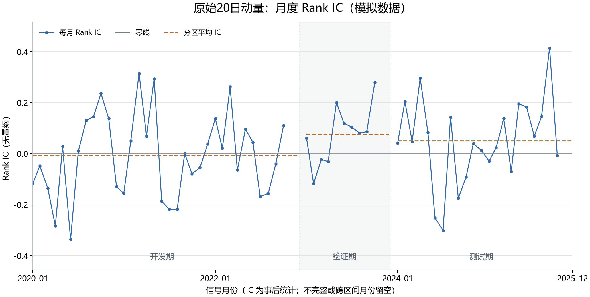

# 第 07 步：我怎样把原始动量与未来收益正确配对

<!-- SNAPSHOT_NOTE -->
## 我的数据准备说明

我在本页记录的是完整快照上的实际运行。如果我从 GitHub 克隆源码，我先在仓库根目录运行 `python publication/restore_snapshot.py`，恢复同版本的 `data/` 与 `runs/`，再执行本步。[完整数据与大型结果索引](../../publication/ASSET_INDEX.md)保留全部路径和哈希；本页图表与 Notebook 已保存输出可直接阅读。


## 我的目标与研究边界

我在前一步已经得到同一天 40 只模拟股票的动量排名。本步我开始回答一个不同的问题：过去涨得相对多的股票，在随后一个持有期内，收益排名是否也相对靠前？我用未来收益标签和单期 Rank IC 检查这种横截面关系。

我始终使用 `SYN001` 至 `SYN040` 的模拟行情。输入目录是 [input](../../runs/first_demo_20261107/input/)，随机种子记录为 `20261102`。模拟日历使用工作日，包含真实 A 股可能休市的日期；本页日期只是这份教学数据中的会话日期。我把这一步的输出解释为事后统计，不把它称为真实 A 股研究结论、可交易净收益或投资胜率。

我本步检验的是 **RAW 原始 20 期动量**，尚未做 MAD 截断、标准化或多因子合成。因此，本页 IC 与项目参考模块中经过预处理的 `z_momentum` IC 可能不同。

## 我的前置条件与运行命令

我已经完成股票代码识别、日历对齐、简单收益率、20 期动量和同日排名。我的输入文件是 `prices.csv`、`calendar.csv`；`ashare_lab` 已在虚拟环境中安装。

我在包含 `pyproject.toml` 的仓库根目录打开 PowerShell。若当前副本还没有虚拟环境，我先完成一次初始化：

```powershell
py -3.12 -m venv .venv
.\.venv\Scripts\python.exe -m pip install -r requirements-tested.txt -e ".[plots]"
```

我随后只运行本步脚本：

```powershell
.\.venv\Scripts\python.exe .\examples\07_forward_returns_rank_ic.py
```

我不需要激活环境，也不需要修改 PowerShell 执行策略。完整入口是 [07_forward_returns_rank_ic.py](../../examples/07_forward_returns_rank_ic.py)。当前脚本把单期配对与统计打印在终端，不单独写出本步 CSV；月度审计文件会在下一步保存。

## 我先固定四个时间点

我把信号日定为 `2020-01-31`。在当天收盘后，我才拥有当天完整收盘价与成交量，因此无法再假设按这个已经过去的收盘价成交。

| 我记录的事件 | 模拟日期 | 我允许使用的信息 |
|---|---|---|
| 我形成动量信号 | 2020-01-31 收盘后 | 截至当天收盘的历史价格 |
| 我定义理论入场 | 2020-02-03 开盘 | 入场日复权开盘价 |
| 我形成下一次信号 | 2020-02-28 收盘后 | 下一次月末已实现的历史信息 |
| 我定义本期理论退出 | 2020-03-02 开盘 | 下次调仓执行日复权开盘价 |

我用下面的时间线约束整个计算：


我把 `2020-02-28` 看作下一信号日，不能直接把它的收盘价当作本期退出价。这样，我后续的因子检验标签才能与“次日开盘执行”的策略规则保持一致。

## 我怎样定义两个变量

我对股票 \(i\) 在信号日 \(T\) 计算原始动量：

$$M_{i,T}=P^{adj,close}_{i,T}/P^{adj,close}_{i,T-20}-1.$$

我按统一模拟日历数 20 个会话间隔，要求覆盖这 20 个间隔的 21 个收盘价完整。这个完整窗口要求是本项目的缺失数据规则；公式本身只涉及两个端点。

我另外定义事后标签：

$$R^{fwd}_{i,T}=P^{adj,open}_{i,exit(T)}/P^{adj,open}_{i,entry(T)}-1.$$

我保留这两个时间方向：`momentum_20` 向过去看，`forward_return` 向未来看。未来价格出现在标签里是必要的事后评估，只有把未来价格放回因子计算或选股决策，才会构成前视偏差。

## 我怎样阅读关键代码

我先对每只股票单独对齐日历，再计算动量：

```python
stock = stock.sort_values("date").set_index("date").reindex(days).reset_index()
stock["symbol"] = symbol
close = stock["adj_close"].where(stock["adj_close"] > 0)
valid_count = close.rolling(21, min_periods=21).count()
stock["momentum_20"] = (close / close.shift(20) - 1).where(valid_count == 21)
```

我用第一行把缺失会话显式留在时间轴上，避免 `shift(20)` 悄悄变成“前 20 条非缺失记录”。我恢复的只有股票代码，价格没有填充。`where` 把非正价格排除；完整窗口掩码使中途缺失不能悄悄通过。

我从信号日截面确定研究对象，然后按股票代码关联未来价格：

```python
paired = snapshot.merge(entry_prices, on="symbol", how="left", validate="one_to_one")
paired = paired.merge(exit_prices, on="symbol", how="left", validate="one_to_one")
paired = paired.dropna(subset=["momentum_20", "entry_open", "exit_open"]).copy()
paired = paired.loc[(paired["entry_open"] > 0) & (paired["exit_open"] > 0)].copy()
paired["forward_return"] = paired["exit_open"] / paired["entry_open"] - 1
```

我用 `left` 保留信号日对象的追踪线索，用 `validate="one_to_one"` 阻止重复键把一只股票扩成多行。我在关联后删除无效配对，随后才排名；若先对更大的股票池排名，再删除缺失标签，剩余名次就不再是匹配样本内的完整秩。

我对两个变量统一从大到小排名，再计算两列秩的 Pearson 相关：

```python
paired["factor_rank"] = paired["momentum_20"].rank(method="average", ascending=False)
paired["return_rank"] = paired["forward_return"].rank(method="average", ascending=False)
rank_ic = paired["factor_rank"].corr(paired["return_rank"])
```

我用 `average` 让并列值共享平均名次，而不是按代码人为制造更强或更弱的信号。两边都降序不会改变相关符号；若只把一边方向反过来，符号会反转。我直接对秩求 Pearson 相关，不依赖 SciPy。

## 我核对到的实际输出

我本期得到 40 个有效配对，无缺失配对排除。SYN001 的理论入场价打印为 `21.508810245409`，退出价打印为 `23.226209805667`；理论收益为 `7.984633%`。它的动量排名为 6，未来收益排名为 9。

| 我观察的股票 | 原始动量排名 | 原始动量 | 理论未来收益 | 未来收益排名 |
|---|---:|---:|---:|---:|
| SYN037 | 1 | 15.703985% | -2.747230% | 34 |
| SYN008 | 2 | 10.858528% | -2.098661% | 33 |
| SYN034 | 3 | 8.161741% | -1.690733% | 29 |
| SYN025 | 4 | 1.816338% | 9.858477% | 6 |
| SYN029 | 5 | 1.328662% | 2.440543% | 21 |

我得到的单期原始动量 Rank IC 是 **`-0.11707317073170734`**，终端按六位小数显示 `-0.117073`。这表示本期整体排名关系略偏反向，不能解释为亏损 11.7073%，也不能解释为某个胜率。

我还用无并列值时的公式独立复核：

$$\rho=1-\frac{6\sum_i d_i^2}{N(N^2-1)}.$$

我核对到 \(N=40\)、\(\sum d_i^2=11908\)，公式结果与秩相关只差浮点舍入。这个简式依赖无并列值条件；一般实现仍使用平均秩加 Pearson 相关。

## 我保存的字段含义与图表参照

我还用一个小例子区分排名关系与赚钱与否。假设某期三只股票的因子从高到低排列，而未来收益依次为百分之一、百分之二、百分之三，我会得到完全反向的排名关系；三只股票却都上涨。反过来，若高分到低分的未来收益依次为负百分之一、负百分之二、负百分之三，排名关系完全同向，股票却都下跌。因此，我不能从一个正相关直接推出持有高分组一定盈利，也不能从一个负相关直接推出所有股票下跌。

我选择秩相关，是为了先检查相对顺序，而不让股票因子的原始单位直接决定统计量。它也有信息损失：第一名比第二名只高一点，还是高出很多，在秩上都只相差一个名次。我因此保留原始因子值与原始收益列，后续再用分组收益和实际组合补充检查。我的一份研究记录不能只留下一个相关系数，而丢掉参与计算的股票名单、持有期和数据口径。

| 字段 | 我的解释 |
|---|---|
| `momentum_20` | 我在信号时点已知的历史动量，小数收益率 |
| `entry_open` / `exit_open` | 我为理论标签取得的复权开盘价 |
| `forward_return` | 我在退出后才能完成的理论持有期收益 |
| `factor_rank` / `return_rank` | 我在同一批有效股票内得到的平均秩 |
| `momentum_pct` / `forward_return_pct` | 我仅为打印而乘以 100 的显示列 |

我在第 08 步保存的月度图中，最左端 `2020-01` 的点正是本步结果。下面是跨步参照，不是本步额外生成的单期图：



## 我记录的常见错误与原因

- 我若按行号拼接两天的价格，就可能把不同股票配在一起；股票代码才是关联键。
- 我若把入场改成 1 月 31 日收盘，就会使用收盘后才形成的信号去占用已经过去的价格。
- 我若直接使用 `shift(-20)` 构造因子，就会把未来变化伪装成历史信号。
- 我若只挑动量第一名讲故事，就会忽略 40 只股票整体的排名关系；本例前三名未来收益都为负，也不能单凭这三只判定整个因子永远无效。
- 我若把标签当作成交收益，就会漏掉佣金、滑点、停牌、涨跌停和买不到时保留现金的影响。
- 我若为了得到正 IC 临时把动量改成反向，就会把本期结果用于事后选择方向。本步方向保持原始动量正向。

## 我的验收与本步结论

我逐项核对：四个时间点正确；配对数为 40；SYN001 的收益与价格比值一致；两列名次来自同一批股票；IC 为约 `-0.117073`；输出中的百分比仅是显示变换。我也能够解释为什么 20 期因子回看长度与月度标签持有期是两套独立规则。

我本步完成了“历史信号—未来标签—同日配对—秩相关”的闭环。我获得的是一个模拟持有期的描述性检验，下一步需要把相同规则扩展到所有月份，观察关系是否持续、是否随时间改变。

<!-- GENERATED_FULL_SOURCE_START -->

## 我的完整脚本源码

我把本步完整实现保留在 [07_forward_returns_rank_ic.py](../../examples/07_forward_returns_rank_ic.py)。精选代码解释在前文，以下代码与脚本文件一致。

```python
"""第七课：未来收益标签与原始动量的单期 Rank IC；全部为模拟数据。"""

from pathlib import Path
import pandas as pd
from ashare_lab.factors import monthly_signal_dates

project_dir = Path(__file__).resolve().parents[1]
data_path = project_dir / "runs" / "first_demo_20261107" / "input" / "prices.csv"
prices = pd.read_csv(data_path, dtype={"symbol": "string"}, parse_dates=["date"])
calendar = pd.read_csv(data_path.with_name("calendar.csv"), parse_dates=["date"])
days = pd.DatetimeIndex(calendar["date"])
lookback = 20

# 1. 复用上一课：每只股票单独计算，只使用当日及之前的价格。
factor_tables = []
for symbol, stock in prices.groupby("symbol", sort=True):
    stock = stock.sort_values("date").set_index("date").reindex(days).reset_index()
    stock["symbol"] = symbol
    close = stock["adj_close"].where(stock["adj_close"] > 0)
    valid_count = close.rolling(lookback + 1, min_periods=lookback + 1).count()
    stock["momentum_20"] = (close / close.shift(lookback) - 1).where(
        valid_count == lookback + 1
    )
    factor_tables.append(stock[["date", "symbol", "momentum_20"]])
factor_values = pd.concat(factor_tables, ignore_index=True)

# 2. 月末收盘信号 -> 下一交易日开盘 -> 下次调仓执行日开盘。
# monthly_signal_dates 返回具有下一执行日的月末日期。
signal_date = pd.Timestamp("2020-01-31")
signal_dates = monthly_signal_dates(days)
if signal_date not in signal_dates:
    raise ValueError("请选择模拟日历中具有下一执行日的月末信号日期。")
signal_index = signal_dates.get_loc(signal_date)
if signal_index + 1 >= len(signal_dates):
    raise ValueError("没有完整的下一持有期，不能构造未来收益标签。")
next_signal_date = signal_dates[signal_index + 1]
entry_date = days[days.get_loc(signal_date) + 1]
exit_date = days[days.get_loc(next_signal_date) + 1]

# 3. 从信号日确定研究对象，再取未来的理论入场、退出价格。
snapshot = factor_values.loc[factor_values["date"] == signal_date].copy()
entry_prices = prices.loc[prices["date"] == entry_date, ["symbol", "adj_open"]].rename(
    columns={"adj_open": "entry_open"}
)
exit_prices = prices.loc[prices["date"] == exit_date, ["symbol", "adj_open"]].rename(
    columns={"adj_open": "exit_open"}
)

# 4. 按股票代码配对，不能假定不同日期的行顺序相同。
paired = snapshot.merge(entry_prices, on="symbol", how="left", validate="one_to_one")
paired = paired.merge(exit_prices, on="symbol", how="left", validate="one_to_one")
paired = paired.dropna(subset=["momentum_20", "entry_open", "exit_open"]).copy()
paired = paired.loc[(paired["entry_open"] > 0) & (paired["exit_open"] > 0)].copy()

# 5. 未来收益只用于事后检验，不放回 signal_date 的动量计算。
# 该标签为复权开盘到开盘的理论毛收益，未计成本、停牌或成交限制。
paired["forward_return"] = paired["exit_open"] / paired["entry_open"] - 1
if (len(paired) < 5 or paired["momentum_20"].nunique() < 2
        or paired["forward_return"].nunique() < 2):
    raise ValueError("有效样本不足或排序变量为常数，不能报告有效 Rank IC。")

# 6. 对同一批有效配对股票排名；并列时使用平均名次。
# 两边都从大到小排，第 1 名都是数值最高者。
paired["factor_rank"] = paired["momentum_20"].rank(method="average", ascending=False)
paired["return_rank"] = paired["forward_return"].rank(method="average", ascending=False)

# 7. 两列秩的 Pearson 相关就是 Spearman/Rank IC，无需 SciPy。
rank_ic = paired["factor_rank"].corr(paired["return_rank"])

# 以下只用于展示；计算中的收益仍然保存为小数。
paired["momentum_pct"] = paired["momentum_20"] * 100
paired["forward_return_pct"] = paired["forward_return"] * 100
view = paired.sort_values(["factor_rank", "symbol"]).reset_index(drop=True)
columns = ["symbol", "momentum_pct", "factor_rank", "forward_return_pct", "return_rank"]
print("全部为模拟数据。momentum_pct、forward_return_pct 两列的单位为 %。")
print("信号日收盘：", signal_date.date())
print("理论入场日开盘：", entry_date.date())
print("下一信号日收盘：", next_signal_date.date())
print("理论退出日开盘：", exit_date.date())
print("有效配对股票数：", len(paired))
print("因缺失或无效价格排除的股票数：", len(snapshot) - len(paired))
print("\n原始动量前 10 名与后续表现：")
print(view[columns].head(10).to_string(index=False))
print(f"\n单期原始动量 Rank IC：{rank_ic:.6f}")
focus = paired.loc[paired["symbol"] == "SYN001"].iloc[0]
print(f"\nSYN001：入场价 {focus['entry_open']:.12f}，退出价 {focus['exit_open']:.12f}")
print(f"理论未来收益：{focus['forward_return']:.6%}")
print(f"因子排名：{focus['factor_rank']:g}；未来收益排名：{focus['return_rank']:g}")
print("\n单期模拟相关不能证明显著性，也不是策略净收益或胜率。")
```

<!-- GENERATED_FULL_SOURCE_END -->

<!-- GENERATED_NAV_START -->

[项目首页](../../README.md) · [本步 Notebook](lesson.ipynb) · [上一步](../06_cross_section_ranking/README.md) · [下一步](../08_monthly_ic_icir/README.md)

<!-- GENERATED_NAV_END -->
