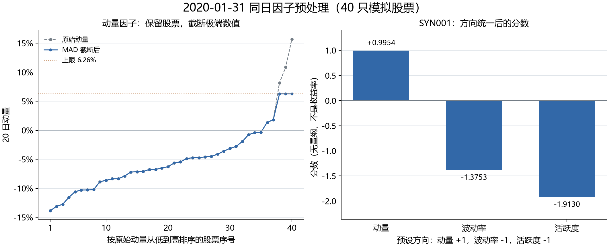

# 第 10 步：我怎样补齐波动率和相对成交量两个原始因子

<!-- SNAPSHOT_NOTE -->
## 我的数据准备说明

我在本页记录的是完整快照上的实际运行。如果我从 GitHub 克隆源码，我先在仓库根目录运行 `python publication/restore_snapshot.py`，恢复同版本的 `data/` 与 `runs/`，再执行本步。[完整数据与大型结果索引](../../publication/ASSET_INDEX.md)保留全部路径和哈希；本页图表与 Notebook 已保存输出可直接阅读。


## 我的目标与前置

我已经完成原始动量的计算、Rank IC 和五分组检验。本步我把因子表从一列扩展成三列：20 期动量、20 期日收益波动率、5 期均量相对 20 期均量。我先确保每个量的数学含义、单位和时间窗口清楚，再进入下一步的预处理与合成。

我本步没有预先证明三个因子有效，也没有把不同单位的原始值直接相加。我继续使用相同 40 只 SYN 模拟股票和工作日日历；数据不代表真实 A 股成交记录。股票代码与价格列的定义可以回查 [输入文件](../../runs/first_demo_20261107/input/)。

我需要理解每只股票独立计算、`shift(1)`、完整滚动窗口，以及原始动量的 21 个价格覆盖 20 个收益间隔。这些知识来自前面的收益率与动量步骤，不要求先生成第 08、09 步输出。

## 我的运行命令与输出位置

我在仓库根目录运行：

```powershell
.\.venv\Scripts\python.exe .\examples\10_volatility_activity.py
```

我使用 [10_volatility_activity.py](../../examples/10_volatility_activity.py)，读取 `runs/first_demo_20261107/input/prices.csv` 和同目录 `calendar.csv`，参数读取 [baseline.json](../../configs/baseline.json)。本步不调用在线接口，也不下载新行情。

我把 `activity_mode` 固定为 `relative_volume`。脚本会在该值不匹配时主动报错，避免把另一种“平均换手率”口径悄悄当成相对成交量。

我生成两个文件：

- [raw_factors.csv](../../publication/ASSET_INDEX.md)：我保留全部历史、全部股票的原始因子，共 73080 行。
- [snapshot_2020-01-31.csv](../../runs/first_demo_20261107/lesson10_raw_factors/snapshot_2020-01-31.csv)：我截取观察日的 40 只股票，供下一步逐项检查。

## 我把“波动率”定义成哪一种量

我先计算简单日收益：

$$r_{i,t}=P^{adj,close}_{i,t}/P^{adj,close}_{i,t-1}-1.$$

我再对最近 20 个日收益计算样本标准差：

$$\bar r_{i,t}=\frac1{20}\sum_{k=0}^{19}r_{i,t-k},$$

$$Vol_{i,t}=\sqrt{\frac{\sum_{k=0}^{19}(r_{i,t-k}-\bar r_{i,t})^2}{19}}.$$

我得到的是**过去 20 个日收益的日频离散程度**。它既不是过去 20 期累计收益，也不是整个 20 期持有期的收益标准差，更没有年化。我选择 `ddof=1`，因此分母是 19；如果使用 `ddof=0`，数值会不同。

我在代码中明确保留上述口径：

```python
stock["daily_return"] = close / close.shift(1) - 1
stock["volatility_20"] = stock["daily_return"].rolling(
    window=lookback, min_periods=lookback
).std(ddof=1)
```

我用第一行生成向过去看的收益。第二部分要求 20 个有效收益都出现后才生成标准差；在完整数据中，这需要 21 个收盘价。若中间价格缺失，相关日收益也会缺失，窗口不会自动缩短成更少的日子。

## 我把“活跃度”定义成相对成交量

我把成交量记为 \(V_{i,t}\)，定义：

$$A_{i,t}=\frac{\frac15\sum_{k=0}^{4}V_{i,t-k}}
{\frac1{20}\sum_{k=0}^{19}V_{i,t-k}}.$$

我在分子和分母中都使用同一只股票的历史成交量，所以比值没有“股”的单位，显示为倍数。我不直接比较不同公司绝对成交量的大小，也不把这个比值叫作换手率；换手率通常还需要可比的流通股本分母，本步没有使用该定义。

```python
volume = stock["volume"].where(stock["volume"] >= 0)
stock["volume_mean_5"] = volume.rolling(5, min_periods=5).mean()
stock["volume_mean_20"] = volume.rolling(20, min_periods=20).mean()
stock["activity_5_20"] = stock["volume_mean_5"] / stock["volume_mean_20"].where(
    stock["volume_mean_20"] > 0
)
```

我允许真实数值零成交量进入均值，不把零当作缺失。若短期均量为零而长期均量为正，比例可以为零；若长期均量为零，除法没有有效分母，我保留缺失而不是无穷大。缺失成交量也不前向填充。

## 我怎样保证每只股票的时间轴正确

我先按股票分组，再对齐统一日历：

```python
for symbol, stock in prices.groupby("symbol", sort=True):
    stock = stock.sort_values("date").set_index("date").reindex(days).reset_index()
    stock["symbol"] = symbol
```

我不能把 40 只股票混在一起后直接 `rolling(20)`，否则窗口可能跨越不同股票。`reindex` 只补日期，不补价格和成交量；我恢复股票代码只是恢复键，不是在制造行情。

我继续保留原始动量的完整价格窗口：

```python
price_count = close.rolling(21, min_periods=21).count()
stock["momentum_20"] = (close / close.shift(20) - 1).where(price_count == 21)
```

我在历史日期逐行计算这些量，即使一次性读取了整个文件，每一行的 `shift` 和向后滚动窗口仍然只使用当时及以前的数据。本步没有用未来标签参与任何计算。

## 我核对 SYN001 的实际值

我在 `2020-01-31` 的快照中核对到：

| 我的字段 | 保存值或显示值 | 我的解释 |
|---|---:|---|
| `momentum_20` | -0.0035457190473298095 | 我过去 20 个间隔累计约 -0.354572% |
| `volatility_20` | 0.024510429203986186 | 我过去 20 个日收益的样本标准差约 2.451043% |
| `volume_mean_5` | 4734666.886390239 | 我最近 5 个会话平均成交量，股 |
| `volume_mean_20` | 3708441.103270679 | 我最近 20 个会话平均成交量，股 |
| `activity_5_20` | 1.276727000521722 | 我短期均量约为长期均量的 1.276727 倍 |
| `all_factors_valid` | True | 我本行三个原始因子都非缺失 |

我把最后的倍数读成“短期均量比长期均量高约 27.6727%”，而不是“换手率等于 127.6727%”。观察日 40 只股票的三个因子都有效。

我用 Python `statistics.stdev` 对相同 20 个日收益作独立核算，得到约 `0.02451042920398614`；与 CSV 的差异只是浮点精度。这个窗口的收益日期是 `2020-01-06` 至 `2020-01-31`，第一条收益还需要 `2020-01-03` 的前一收盘价。相同窗口的日收益均值约为 `0.0001085374445081`，不能拿它代替波动率。

## 我怎样解释不同的预热长度

| 我的原始因子 | 首个有效位置，零起点 | 首个有效日期 | 我的有效输入要求 |
|---|---:|---|---|
| 动量 | 20 | 2019-01-29 | 我需要 21 个收盘价覆盖 20 个间隔 |
| 波动率 | 20 | 2019-01-29 | 我需要 20 个日收益，也就是 21 个收盘价 |
| 相对成交量 | 19 | 2019-01-28 | 我只需要 20 个成交量观测 |

我因此保留波动率前 20 行缺失、活跃度前 19 行缺失。活跃度较早一天出现不是索引错位，而是输入对象不同。我不把预热缺失补成零，避免让尚未形成的因子假装存在。

## 我的字段与后续图表参照

我用缩放来检查相对成交量的含义。如果同一股票的全部成交量同时乘以十，五期均量与二十期均量都会乘以十，比值保持不变。这个性质说明，我比较的是该股票近期成交相对自身历史的变化，而不是把“成交股数多”直接当作更强信号。但我也不把这种尺度消除夸大成完全可比：市场结构、数据口径或股份变化仍可能影响成交量序列，正式数据研究仍需检查来源。

我同样用正负收益检查波动率。日收益在正负之间来回变化，可以具有很高标准差，即使最终累计收益接近零；持续缓慢下跌也可能具有较小标准差。因此，波动率刻画波动，不直接给出上涨方向。动量、波动率和相对成交量分别描述不同维度，我先保留各自定义，才有理由研究它们是否互补。

我在观察日收盘后才知道当天完整成交量与收盘价，所以包含当天数据的三个因子也只能在收盘后形成。后续即使选取低波动与低活跃度方向，我也仍需在下一会话执行。多算两列历史特征不会改变信号与成交必须错开的时间约束。

我在历史表中同时保存 `daily_return`、两列均量和三个原始因子，使每个比值都能够从中间量回算。`all_factors_valid` 是本课的非缺失检查标记；输入数值合法性仍然依赖前面的数据校验，后续预处理还会显式清理无穷值。

我本步脚本只保存表格，没有单独生成 PNG。下面引用的是第 11 步已保存的同日预处理图，作为下一步的衔接：左侧仍可见本步的原始动量，右侧则是下一步得到的无量纲分数。我不把右侧分数当作本步的原始波动率或活跃度。



## 我记录的常见错误与验收

- 我若把股价本身的标准差当作收益波动率，就会让价格尺度主导比较。
- 我若使用 `ddof=0`，就与本项目的样本标准差口径不同。
- 我若把日频标准差直接写成年化风险，就会错误标注单位；本步没有乘以任何年化系数。
- 我若跳过缺失会话或前向填充成交量，就可能改变因子的真实窗口内容。
- 我若把三个原始值直接平均，就会混合小数收益、标准差和倍数；不同尺度会使权重失真。
- 我若把低波动、低活跃度方向写成既定规律，就会把研究假设误写成研究结论。

我的验收是：40 只股票独立计算；观察日三因子均有效；SYN001 数值与中间均量能够勾稽；两种预热长度能够解释；所有窗口只用过去信息。我本步得到了一张可解释、可追踪的原始三因子表，下一步才解决极端值、单位和方向问题。

<!-- GENERATED_FULL_SOURCE_START -->

## 我的完整脚本源码

我把本步完整实现保留在 [10_volatility_activity.py](../../examples/10_volatility_activity.py)。精选代码解释在前文，以下代码与脚本文件一致。

```python
"""第十课：补齐波动率和相对成交量，得到原始三因子表；模拟数据。"""

from pathlib import Path
import pandas as pd
from ashare_lab.config import load_config

project_dir = Path(__file__).resolve().parents[1]
data_path = project_dir / "runs" / "first_demo_20261107" / "input" / "prices.csv"
prices = pd.read_csv(data_path, dtype={"symbol": "string"}, parse_dates=["date"])
calendar = pd.read_csv(data_path.with_name("calendar.csv"), parse_dates=["date"])
days = pd.DatetimeIndex(calendar["date"])
config = load_config(project_dir / "configs" / "baseline.json")
lookback = config["lookback"]
short_window = config["activity_short"]
long_window = config["activity_long"]
if config["activity_mode"] != "relative_volume":
    raise ValueError("本课演示相对成交量，请使用 activity_mode=relative_volume 的配置。")

# 1. 每只股票独立计算；缺失交易日只补日期，不补价格或成交量。
factor_tables = []
for symbol, stock in prices.groupby("symbol", sort=True):
    stock = stock.sort_values("date").set_index("date").reindex(days).reset_index()
    stock["symbol"] = symbol
    close = stock["adj_close"].where(stock["adj_close"] > 0)
    volume = stock["volume"].where(stock["volume"] >= 0)

    # 2. 日收益率和原有的 20 日动量；保持完整的 21 价格窗口要求。
    stock["daily_return"] = close / close.shift(1) - 1
    price_count = close.rolling(lookback + 1, min_periods=lookback + 1).count()
    stock["momentum_20"] = (close / close.shift(lookback) - 1).where(
        price_count == lookback + 1
    )

    # 3. 最近 20 个日收益率的样本标准差，日频、未年化。
    stock["volatility_20"] = stock["daily_return"].rolling(
        window=lookback, min_periods=lookback
    ).std(ddof=1)

    # 4. 相对成交量：5 日均量 / 20 日均量，单位为倍数。
    stock["volume_mean_5"] = volume.rolling(short_window, min_periods=short_window).mean()
    stock["volume_mean_20"] = volume.rolling(long_window, min_periods=long_window).mean()
    stock["activity_5_20"] = stock["volume_mean_5"] / stock["volume_mean_20"].where(
        stock["volume_mean_20"] > 0
    )

    factor_tables.append(stock[[
        "date", "symbol", "daily_return", "momentum_20", "volatility_20",
        "volume_mean_5", "volume_mean_20", "activity_5_20",
    ]])

# 5. 拼接原始因子表，记录三个因子是否同时有效。
raw_factors = pd.concat(factor_tables, ignore_index=True)
factor_columns = ["momentum_20", "volatility_20", "activity_5_20"]
raw_factors["all_factors_valid"] = raw_factors[factor_columns].notna().all(axis=1)

# 6. 本课只观察信号日截面和 SYN001 历史；不对不同单位的原始值直接求和。
signal_date = pd.Timestamp("2020-01-31")
snapshot = raw_factors.loc[raw_factors["date"] == signal_date].sort_values("symbol").copy()
focus_symbol = "SYN001"
focus = raw_factors.loc[raw_factors["symbol"] == focus_symbol].sort_values("date").reset_index(drop=True)
row = snapshot.loc[snapshot["symbol"] == focus_symbol].iloc[0]

# 7. 保存数值原始精度，供下一课去极值、标准化和因子合成使用。
output_dir = data_path.parent.parent / "lesson10_raw_factors"
output_dir.mkdir(parents=True, exist_ok=True)
raw_factors.to_csv(output_dir / "raw_factors.csv", index=False, date_format="%Y-%m-%d")
snapshot.to_csv(output_dir / "snapshot_2020-01-31.csv", index=False, date_format="%Y-%m-%d")

print("全部为模拟数据；本课只计算原始因子，未合成分数。")
print("观察日期：", signal_date.date())
print("当日股票数：", len(snapshot))
print("当日三个因子都有效的股票数：", int(snapshot["all_factors_valid"].sum()))
print(f"\n{focus_symbol}：")
print(f"20 日动量：{row['momentum_20']:.6%}")
print(f"20 日波动率（日收益样本标准差，未年化）：{row['volatility_20']:.6%}")
print(f"相对成交量（5 日均量 / 20 日均量）：{row['activity_5_20']:.6f} 倍")
print(f"5 日均量：{row['volume_mean_5']:.6f} 股")
print(f"20 日均量：{row['volume_mean_20']:.6f} 股")
print("\n预热期结束附近：")
print(focus.loc[17:22, ["date", "momentum_20", "volatility_20", "activity_5_20"]].to_string(index=True))
for name in factor_columns:
    index = focus[name].first_valid_index()
    print(f"{name}：首个有效行索引 {index}，日期 {focus.loc[index, 'date']:%Y-%m-%d}")
print("\n本课结果目录：", output_dir)
```

<!-- GENERATED_FULL_SOURCE_END -->

<!-- GENERATED_NAV_START -->

[项目首页](../../README.md) · [本步 Notebook](lesson.ipynb) · [上一步](../09_quintile_returns/README.md) · [下一步](../11_factor_preprocessing/README.md)

<!-- GENERATED_NAV_END -->
