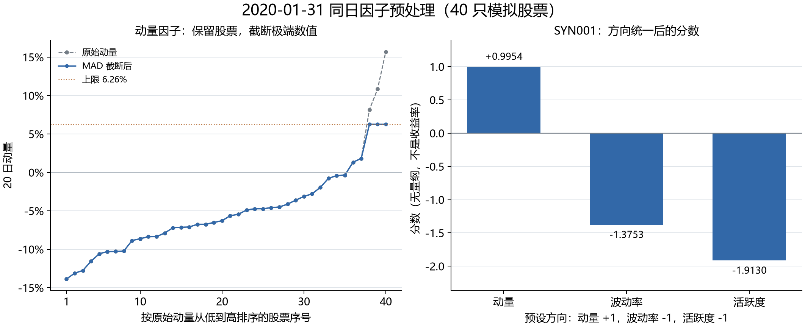

# 第 11 步：我怎样做同日 MAD 截断、标准化和方向统一

<!-- SNAPSHOT_NOTE -->
## 我的数据准备说明

我在本页记录的是完整快照上的实际运行。如果我从 GitHub 克隆源码，我先在仓库根目录运行 `python publication/restore_snapshot.py`，恢复同版本的 `data/` 与 `runs/`，再执行本步。[完整数据与大型结果索引](../../publication/ASSET_INDEX.md)保留全部路径和哈希；本页图表与 Notebook 已保存输出可直接阅读。


## 我的目标与运行前置

我已经在上一课得到动量、波动率、相对成交量三个原始因子。本步我解决三件具体问题：个别极端值可能影响尺度估计；三个因子的单位和分散程度不同；原始值越大并不都对应同一偏好方向。我按固定顺序处理这些问题，并保存每一个中间结果。

我处理的是 `2020-01-31` 的 40 只 SYN 模拟股票截面，既不是一只股票跨多年的历史标准化，也不是把整个训练和测试区间混在一起拟合统计量。我没有在这一步得出低波动、低活跃度必然赚钱的结论。

我在仓库根目录按顺序运行：

```powershell
# 我先确保上一课的原始因子表存在。
.\.venv\Scripts\python.exe .\examples\10_volatility_activity.py
.\.venv\Scripts\python.exe .\examples\11_factor_preprocessing.py
```

我使用 [11_factor_preprocessing.py](../../examples/11_factor_preprocessing.py)，输入为 [raw_factors.csv](../../publication/ASSET_INDEX.md)。绘图库来自环境中的 `.[plots]` 可选依赖。我不运行在线数据下载，也不更改因子方向配置。

## 我先清理值，再计算中位数和 MAD

我对某一天某个因子的有效值 \(x_i\) 计算：

$$m=median(x_i),\qquad MAD=median(|x_i-m|).$$

我采用固定边界：

$$L=m-3\times1.4826\times MAD,\qquad U=m+3\times1.4826\times MAD.$$

我把超过边界的数值压到边界，而不是删除对应股票：

$$x_i^{clip}=\min(\max(x_i,L),U).$$

我在函数开头显式处理无穷值和缺失：

```python
clean = values.replace([np.inf, -np.inf], np.nan).astype(float)
valid = clean.dropna()
median = valid.median()
mad = (valid - median).abs().median()
```

我让无效值不进入截面统计，同时保持它原来的行索引；这样后续结果能够正确对回股票代码。我不把缺失值补零，因为零可能是一个真实的中性数值。

```python
clipped = clean.copy()
if mad > 0:
    distance = mad_scale * 1.4826 * mad
    lower, upper = median - distance, median + distance
    clipped = clean.clip(lower=lower, upper=upper)
```

我通过 `copy()` 保留原始列作为审计依据。MAD 为零时，我跳过截断，避免把“多数值相同但仍有少数差异”的截面全部压成同一值。我把这种行为写成明确规则，而不是让零尺度导致不明结果。

## 我怎样计算 Z-score 与方向分数

我对截断后的有效值计算总体均值和总体标准差：

$$\mu=\frac1N\sum_i x_i^{clip},\quad
\sigma=\sqrt{\frac1N\sum_i(x_i^{clip}-\mu)^2},\quad
z_i=(x_i^{clip}-\mu)/\sigma.$$

我在这里用 `ddof=0`，与上一课日收益波动率的 `ddof=1` 不同：上一课估计时间窗口内的收益样本波动，本课则直接描述当前整个可用截面的离散尺度。

我从配置取得方向 \(d_j\)，计算最终得分 \(s_{i,j}=d_jz_{i,j}\)。当前冻结方向为动量 `+1`、波动率 `-1`、活跃度 `-1`。我把最终得分解释为“按本次预设偏好衡量，分数越高越优先”，不把方向假设当成有效性证据。

```python
mean = clipped.mean()
std = clipped.std(ddof=0)
z_before_direction = pd.Series(np.nan, index=values.index, dtype=float)
if len(valid) >= 2:
    tolerance = np.finfo(float).eps * max(1.0, abs(float(mean)))
    if std <= tolerance:
        z_before_direction.loc[valid.index] = 0.0
    else:
        z_before_direction.loc[valid.index] = (clipped.loc[valid.index] - mean) / std
score = direction * z_before_direction
```

我先把输出初始化为缺失。少于两个有效值时，我保留缺失，不伪造“可估计的标准分”。恒定截面在浮点容差内没有分散度，我把有效行分数设为零；原来缺失的行仍然缺失。

我注意到核心模块 [factors.py](../../src/ashare_lab/factors.py) 把方向放在截断前，而本课把方向放在最后。对 `+1/-1` 和对称 MAD 边界，这两种顺序代数等价：负向变换翻转中位数、保持 MAD 和标准差，并对称翻转上下界。我没有因此创建另一套研究口径。

## 我核实动量截断的实际数字

我从 [cross_section_stats.csv](../../runs/first_demo_20261107/lesson11_preprocessing/cross_section_stats.csv) 核对到：

| 我的动量统计项 | 保存值 |
|---|---:|
| 有效股票数 | 40 |
| 中位数 | -0.05962510466514485 |
| MAD | 0.027485073931969698 |
| 截断下界 | -0.18187321649975968 |
| 截断上界 | 0.06262300716946997 |
| 截断股票数 | 3 |
| 截断后均值 | -0.053087337603415975 |
| 截断后总体标准差 | 0.04976908653749861 |

我发现 SYN008、SYN034、SYN037 三只股票的原始动量高于上界，均被截为约 `6.262301%`。我仍保留全部 40 只股票；三只高端股票会因此拥有相同的动量标准分，约 `2.324944`。

我对波动率和活跃度都没有发现超出本次边界的值。波动率的计算下界约为 `-0.002090799`，这只是对称统计边界落到零以下，并不表示原始波动率可以为负。

| 我的因子 | 截断后均值 | 截断后总体标准差 | 截断数量 | 方向 |
|---|---:|---:|---:|---:|
| 动量 | -0.0530873376 | 0.0497690865 | 3 | +1 |
| 波动率 | 0.0176316813 | 0.0050014748 | 0 | -1 |
| 活跃度 | 0.9985831735 | 0.1453980439 | 0 | -1 |

## 我怎样解释 SYN001 的三个结果

| 我的因子 | 原始值 | 方向前 Z-score | 方向后得分 |
|---|---:|---:|---:|
| 动量 | -0.0035457190 | 0.9954295327 | 0.9954295327 |
| 波动率 | 0.0245104292 | 1.3753439037 | -1.3753439037 |
| 活跃度 | 1.2767270005 | 1.9129819053 | -1.9129819053 |

我看到 SYN001 的原始动量为负，动量得分仍为正，因为它比这一天截断后的截面均值更高。正得分描述相对位置，不表示原始收益一定为正，更不是未来收益预测值。

我把波动率和活跃度得分变为负，是因为它们高于截面均值，而当前配置偏好低波动、低活跃度。这个符号来自事先选择的研究假设，不来自后来观察到的收益。

我核对三列最终得分的均值均约为零，总体标准差均约为一。CSV 中约 `1e-16` 的均值残差是正常浮点误差，我不会为了显示整齐而在计算阶段提前四舍五入。

## 我怎样阅读图表和中间字段

我可以手工核对 SYN001 的动量分数：我把约负百分之零点三五四六的动量，减去截断后约负百分之五点三零八七的均值，再除以约百分之四点九七六九的总体标准差，得到约正零点九九五四。这个结果说明它高于当天截面均值约一个标准差，而不是说明它未来会赚接近百分之一百。

我也用三个边界场景检查处理规则。若截面只有一只有效股票，我没有足够的横截面分散信息，输出仍为空；若所有有效值完全相同，我把它们设成零分，因为当前因子不能区分股票；若多数值为零但有少数不同值，中位数绝对偏差可能仍为零，我会跳过截断，再由实际标准差判断是否能够标准化。这三种情况不能都用同一个“补零”动作替代。

我把截断理解为一种事先固定的数值处理规则，而不是证明极端值一定是错误数据。极端因子也可能来自真实变化，所以我保留原始值、阈值和截断标记，后续才能判断处理是否合理。若真实来源存在单位错误或价格错误，我应回到数据层修复，而不是指望去极值掩盖问题。

我不对标准分附加正态分布保证。即使分数均值为零、标准差为一，也不能由此推出某个分数对应固定的尾部概率。当前标准化只改变尺度；横截面可以偏斜、厚尾、离散，也可以因为截断出现并列。



我在左图看到灰色原始高端值被蓝线压到同一上限，而不是三只股票消失。我在右图看到三个已经无量纲化并统一方向的得分，纵轴不能标成收益率。

| 输出 | 我的复核用途 |
|---|---|
| [processed_snapshot.csv](../../runs/first_demo_20261107/lesson11_preprocessing/processed_snapshot.csv) | 我保留同日原始值、截断值、方向前分数与最终 `z_*` |
| [factor_steps.csv](../../runs/first_demo_20261107/lesson11_preprocessing/factor_steps.csv) | 我以股票与因子为键逐行追踪 `raw → clipped → z_before_direction → score` |
| [cross_section_stats.csv](../../runs/first_demo_20261107/lesson11_preprocessing/cross_section_stats.csv) | 我检查边界、数量、方向和状态 |

我特别记住 `z_momentum`、`z_volatility`、`z_activity` 已经包含方向处理。下一步再次乘以方向会把负向因子反转回去，属于重复处理。

## 我记录的常见错误与验收

- 我若用整段历史或未来测试期估计统一均值与标准差，就改变了本项目的同日横截面规则，并可能引入未来信息。
- 我若把截断叫作删除异常股票，就会误解当前做法；本步保留股票，只改变极端数值。
- 我若认为标准化必然改变排名，就会混淆两件事：正向线性 Z-score 本身保留顺序，MAD 截断会制造并列值。
- 我若直接把标准分叫作收益率或上涨概率，就会给它添加没有计算过的含义。
- 我若在有效数不足时补零，就会把无法估计的分数与真实中性分数混在一起。

我的验收是：三因子各处理 40 个值；只有动量三只被截断；SYN001 三个得分与表格一致；正常截面的均值约零、总体标准差约一；缺失与恒定截面规则能够解释。我本步得到三列可比较的方向分数，下一步才对它们各赋三分之一权重。

<!-- GENERATED_FULL_SOURCE_START -->

## 我的完整脚本源码

我把本步完整实现保留在 [11_factor_preprocessing.py](../../examples/11_factor_preprocessing.py)。精选代码解释在前文，以下代码与脚本文件一致。

```python
"""第十一课：同日 MAD 去极值、Z-score 标准化和预设方向统一；模拟数据。"""

from pathlib import Path
import numpy as np
import pandas as pd
import matplotlib
from ashare_lab.config import load_config

matplotlib.use("Agg")
import matplotlib.pyplot as plt
from matplotlib.ticker import PercentFormatter


def preprocess_factor(values, direction, mad_scale=3.0):
    """仅处理一个日期的一个因子，返回逐股票步骤表及截面统计量。"""
    clean = values.replace([np.inf, -np.inf], np.nan).astype(float)
    valid = clean.dropna()
    median = valid.median()
    mad = (valid - median).abs().median()

    # MAD 为零时跳过截断，避免把非恒定截面全部压成同一个值。
    clipped = clean.copy()
    lower, upper = np.nan, np.nan
    if mad > 0:
        distance = mad_scale * 1.4826 * mad
        lower, upper = median - distance, median + distance
        clipped = clean.clip(lower=lower, upper=upper)

    mean = clipped.mean()
    std = clipped.std(ddof=0)
    z_before_direction = pd.Series(np.nan, index=values.index, dtype=float)
    status = "insufficient_valid"
    if len(valid) >= 2:
        # 数值精度容差，匹配项目核心模块的恒定截面处理。
        tolerance = np.finfo(float).eps * max(1.0, abs(float(mean)))
        if std <= tolerance:
            z_before_direction.loc[valid.index] = 0.0
            status = "constant_cross_section"
        else:
            z_before_direction.loc[valid.index] = (clipped.loc[valid.index] - mean) / std
            status = "ok"
    score = direction * z_before_direction

    stages = pd.DataFrame({"raw": clean, "clipped": clipped,
                           "z_before_direction": z_before_direction, "score": score})
    stats = dict(n_valid=len(valid), median=median, mad=mad, lower_bound=lower,
        upper_bound=upper, n_clipped=int((clean.notna() & clean.ne(clipped)).sum()),
        clipped_mean=mean, clipped_std=std, direction=direction,
        score_mean=score.mean(), score_std=score.std(ddof=0), status=status)
    return stages, stats


def main():
    project_dir = Path(__file__).resolve().parents[1]
    run_dir = project_dir / "runs" / "first_demo_20261107"
    raw = pd.read_csv(run_dir / "lesson10_raw_factors" / "raw_factors.csv",
                      dtype={"symbol": "string"}, parse_dates=["date"])
    config = load_config(project_dir / "configs" / "baseline.json")
    signal_date = pd.Timestamp("2020-01-31")

    # 1. 只取当天截面，不把其他日期或未来测试期的统计量用于标准化。
    snapshot = raw.loc[raw["date"] == signal_date].sort_values("symbol").reset_index(drop=True)
    if snapshot.empty or snapshot["symbol"].duplicated().any():
        raise ValueError("当天截面为空或股票代码重复，请检查上一课输出。")
    specs = {"momentum": "momentum_20", "volatility": "volatility_20", "activity": "activity_5_20"}
    processed = snapshot[["date", "symbol", *specs.values()]].copy()
    stage_tables, statistic_rows = [], []

    # 2. 同一天内，各因子各自处理；方向来自预先固定的配置。
    for factor, column in specs.items():
        direction = config["directions"][factor]
        stages, stats = preprocess_factor(snapshot[column], direction, config["mad_scale"])
        processed[f"clipped_{factor}"] = stages["clipped"]
        processed[f"z_before_{factor}"] = stages["z_before_direction"]
        # z_* 字段是已统一方向的分数，命名与项目核心模块保持一致。
        processed[f"z_{factor}"] = stages["score"]
        stage_tables.append(stages.assign(date=signal_date, symbol=snapshot["symbol"],
                                          factor=factor, direction=direction))
        statistic_rows.append(dict(factor=factor, **stats))
    all_stages = pd.concat(stage_tables, ignore_index=True)
    statistics = pd.DataFrame(statistic_rows)

    # 3. 保存每一步中间值；本课尚未求三因子的合成分数。
    output_dir = run_dir / "lesson11_preprocessing"
    output_dir.mkdir(parents=True, exist_ok=True)
    processed.to_csv(output_dir / "processed_snapshot.csv", index=False, date_format="%Y-%m-%d")
    statistics.to_csv(output_dir / "cross_section_stats.csv", index=False)
    all_stages.to_csv(output_dir / "factor_steps.csv", index=False, date_format="%Y-%m-%d")

    # 4. 左图展示动量截断；右图展示 SYN001 统一方向后的三个分数。
    plt.rcParams["font.sans-serif"] = ["Microsoft YaHei", "SimHei", "DejaVu Sans"]
    plt.rcParams["axes.unicode_minus"] = False
    plt.rcParams["font.size"] = 11
    fig, (ax_raw, ax_score) = plt.subplots(1, 2, figsize=(11.8, 4.8), layout="constrained")
    ordered = processed.sort_values(["momentum_20", "symbol"]).reset_index(drop=True)
    positions = np.arange(1, len(ordered) + 1)
    upper = statistics.loc[statistics["factor"] == "momentum", "upper_bound"].iloc[0]
    ax_raw.plot(positions, ordered["momentum_20"], color="#747D86", marker="o",
                markersize=3.3, linewidth=1.1, linestyle="--", label="原始动量")
    ax_raw.plot(positions, ordered["clipped_momentum"], color="#3268A8", marker="o",
                markersize=3, linewidth=1.4, label="MAD 截断后")
    ax_raw.axhline(upper, color="#B46A31", linewidth=1, linestyle=":", label=f"上限 {upper:.2%}")
    ax_raw.axhline(0, color="#AEB7BF", linewidth=0.7)
    ax_raw.yaxis.set_major_formatter(PercentFormatter(xmax=1, decimals=0))
    ax_raw.set_title("动量因子：保留股票，截断极端数值", fontsize=12)
    ax_raw.set_xlabel("按原始动量从低到高排序的股票序号")
    ax_raw.set_ylabel("20 日动量")
    ax_raw.set_xticks([1, 10, 20, 30, 40])
    ax_raw.legend(loc="upper left", frameon=False, fontsize=9)

    focus = processed.loc[processed["symbol"] == "SYN001"].iloc[0]
    scores = [focus["z_momentum"], focus["z_volatility"], focus["z_activity"]]
    ax_score.bar(["动量", "波动率", "活跃度"], scores, color="#3268A8", width=0.6)
    ax_score.axhline(0, color="#747D86", linewidth=0.9)
    for index, value in enumerate(scores):
        ax_score.annotate(f"{value:+.4f}", xy=(index, value), xytext=(0, 5 if value >= 0 else -6),
                          textcoords="offset points", ha="center",
                          va="bottom" if value >= 0 else "top", fontsize=10)
    ax_score.set_ylim(min(scores) - 0.45, max(scores) + 0.4)
    ax_score.set_title("SYN001：方向统一后的分数", fontsize=12)
    ax_score.set_ylabel("分数（无量纲，不是收益率）")
    ax_score.set_xlabel("预设方向：动量 +1，波动率 -1，活跃度 -1")
    for ax in (ax_raw, ax_score):
        ax.grid(axis="y", color="#DCE2E8", linewidth=0.7)
        ax.set_axisbelow(True)
        ax.spines[["top", "right"]].set_visible(False)
    fig.suptitle("2020-01-31 同日因子预处理（40 只模拟股票）", fontsize=16)
    fig.savefig(output_dir / "factor_preprocessing.png", dpi=180)
    plt.close(fig)

    print("模拟数据；只使用当天截面；预设方向属于研究假设。")
    print("\n截面统计（阈值与原因子单位相同）：")
    print(statistics.to_string(index=False))
    print("\nSYN001 各步骤：")
    print(all_stages.loc[all_stages["symbol"] == "SYN001",
          ["factor", "raw", "clipped", "z_before_direction", "direction", "score"]].to_string(index=False))
    print("\n发生数值截断的动量股票：")
    mask = processed["momentum_20"].ne(processed["clipped_momentum"])
    print(processed.loc[mask, ["symbol", "momentum_20", "clipped_momentum", "z_momentum"]].to_string(index=False))
    print("\n本课结果目录：", output_dir)


if __name__ == "__main__":
    main()
```

<!-- GENERATED_FULL_SOURCE_END -->

<!-- GENERATED_NAV_START -->

[项目首页](../../README.md) · [本步 Notebook](lesson.ipynb) · [上一步](../10_volatility_activity/README.md) · [下一步](../12_equal_weight_selection/README.md)

<!-- GENERATED_NAV_END -->
