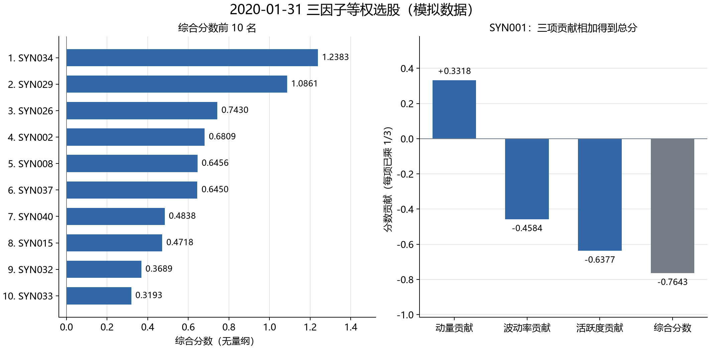

# 第 13 步：我把目标名单变成首次成交与持仓账

<!-- SNAPSHOT_NOTE -->
## 我的数据准备说明

我在本页记录的是完整快照上的实际运行。如果我从 GitHub 克隆源码，我先在仓库根目录运行 `python publication/restore_snapshot.py`，恢复同版本的 `data/` 与 `runs/`，再执行本步。[完整数据与大型结果索引](../../publication/ASSET_INDEX.md)保留全部路径和哈希；本页图表与 Notebook 已保存输出可直接阅读。


## 我的目标：让选股分数进入账户，而不是直接变成收益

我在第 12 步已经得到三因子综合分数、前十名股票和每只 10% 的目标权重。本步我只处理第一次执行：2020-01-31 收盘形成目标，2020-02-03 开盘尝试买入，再按当天收盘价格计算权益。我刻意把“想买多少”“允许买多少”“资金够买多少”和“最后持有多少”分开保存。综合分数是排序依据，目标权重是计划，成交与持仓才决定账户损益。

我使用的是人工行情。`SYN034` 等代码不对应真实上市公司，日历也只是包含节假日的工作日序列。本步的数量是复权价格下可分割的小数单位，目的在于理解现金记账；我不把它叫作交易所原始股数，也不把这次模拟执行写成实盘成交。

## 我的前置文件与精确运行方式

我在仓库根目录，也就是包含 `pyproject.toml` 的目录执行命令。我已经按前面的步骤创建 `.venv` 并安装依赖；在新环境中，我先执行：

```powershell
py -3.12 -m venv .venv
.\.venv\Scripts\python.exe -m pip install -r requirements-tested.txt -e ".[plots]"
```

我保留这几个前置文件，不重新随机生成另一批数据：

| 我的输入 | 我在本步使用的内容 |
| --- | --- |
| [目标名单](../../runs/first_demo_20261107/lesson12_equal_weight_selection/target_portfolio.csv) | 10 个代码、10% 权重、100 万参考资金、执行日期 |
| [完整综合排名](../../runs/first_demo_20261107/lesson12_equal_weight_selection/composite_ranking.csv) | 信号日全部股票的 `composite`，用于确认名单没有被执行日行情改写 |
| [固定模拟输入](../../runs/first_demo_20261107/input/metadata.json) | 同一批模拟价格、市场日历和股票池的来源说明 |
| [固定配置](../../configs/baseline.json) | 初始资金、前十名规则和教学费率 |

我运行本步脚本：

```powershell
.\.venv\Scripts\python.exe examples/13_first_execution.py
```

如果第 12 步的结果尚未生成，我先按第 10、11、12 步的顺序运行相应脚本。我不会只生成一个不同名称的 `runs/my_demo`，然后假设本课自动读取它；当前教学脚本使用固定目录 `runs/first_demo_20261107`。我重跑本步会覆盖本步的五份结果文件，因此自定义实验另存目录。



这张已有图解释我为什么得到当前名单；它不表示任何成交价，也不展示本步收益。我把选股依据和交易结果分开阅读。

## 我的时间轴与第一条防错规则

我的时间轴只有三个节点：信号日收盘、下一交易日开盘、执行日收盘。2020-01-31 的价格与成交量可以参与收盘后评分，但我不能回头按当天收盘价建仓。2020-02-03 的开盘价用来计算模拟成交，收盘价只用于本日最终估值。首次买入前账户里没有股票，因此 1 月 31 日收盘到 2 月 3 日开盘的涨跌不属于新持仓。

我通过日历查找下一交易日，而不是简单把日期加一。脚本中的关键检查是：

```python
location = calendar.get_loc(signal_date)
if location + 1 >= len(calendar) or calendar[location + 1] != execution_date:
    raise ValueError("执行日必须是信号日之后的下一个交易日。")
```

我先用 `get_loc` 找到信号日在市场日历中的位置，再检查后一个位置是否等于保存的执行日。这个检查保护的是交易时点，不是预测准确率。接下来我从完整排名中按 `composite` 降序、代码升序取前十名，并与目标 CSV 的顺序核对。我没有用下一天是否上涨来替换名单。

## 我的资金公式：先计算需求，再按现金缩量

我设初始现金为 (C_0=1,000,000)，每只股票的名义目标市值为 (V_i=100,000)。设复权开盘价为 (P_i^o)，滑点率为 (s=0.0005)，佣金率为 (c=0.0003)。我先计算不含费用的目标单位数和含滑点成交价：

$$
q_i^*=\frac{V_i}{P_i^o},\qquad P_i^{fill}=P_i^o(1+s).
$$

如果我直接买足全部目标数量，所需现金是：

$$
C_{need}=\sum_i q_i^*P_i^{fill}(1+c)=1,000,800.15.
$$

需求超过现金，所以我把可执行买单统一缩放：

$$
\alpha=\min(1,C_0/C_{need})=0.9992004897281440,
\qquad q_i=\alpha q_i^*.
$$

我没有把手续费从账户外补入，也没有让现金变成负数。这个场景中十只股票的模拟 `can_buy` 都为真，`status_known` 也为真，所以全部进入资金需求计算。真实数据里的未知状态不适用于本人工场景；我在本步配置 `allow_unknown_status=False`，要求模拟状态明确。

我复用已经测试过的核心引擎，而不是另写一套与后续回测不一致的成交公式：

```python
config.update(start=str(signal_date.date()), end=str(execution_date.date()),
              top_n=len(targets), allow_unknown_status=False)
result = run_backtest(prices, scores, calendar, config)
```

我在第一行把运行区间限制到信号日与首次执行日，明确目标数量和状态要求；第二行把价格、信号、完整日历交给同一个引擎。`run_backtest` 返回每日账户、成交、持仓和订单四张表。这样本步第一次买入可以与第 14、15 步的连续账户直接对账。

## 我手算一行 SYN034

我从实际保存的模拟价格取出 `SYN034` 的开盘价 `30.842756632269566`、收盘价 `31.207047767024797`。我得到：

| 我的核算字段 | 本次值 |
| --- | ---: |
| 不含费目标数量 (q_i^*) | 3242.252344441026 |
| 含滑点成交价 | 30.858178010586 |
| 资金约束后的成交数量 | 3239.660130387696 |
| 成交金额 `notional` | 99970.0089973008 |
| 佣金 `commission` | 29.9910026992 |
| 以原开盘价衡量的滑点损失 | 49.9600244864 |
| 收盘权重 | 10.0030118866% |

我看到的 `quantity` 并不是整数，原因是教学引擎允许复权单位可分割，不是因为现实交易所允许任意小数股。我也没有对买入收取卖出税；本项目的 `sell_tax_bps` 只在卖出时作用。固定费率本身是教学参数，不是完整的历史收费表。

## 我区分现金账和权益损益账

我的现金只按实际支付金额变化：

$$
C_{end}=C_0-\sum_i notional_i-\sum_i commission_i.
$$

滑点已经把买入价从 (P_i^o) 推高到 (P_i^{fill})，所以我不能在这个现金公式中再减一次滑点。为了理解经济损失，我另写权益分解：

$$
E_{close}=C_0-commission-slippage
          +\sum_iq_i(P_i^c-P_i^o).
$$

我在脚本中分别核对这两个恒等式：

```python
cash_from_ledger = initial - notional - commission - tax
equity_from_ledger = initial - commission - tax - slippage + intraday_profit
```

第一行是实际现金流口径，第二行是相对未加滑点开盘估值的损益分解。我把它们保存到 `ledger.csv` 的 `cash`、`equity` 两个 `section`，不能把整张账表所有行相加。`row_type=total` 是已经汇总后的终值，也不能再加进组成项。

## 我保存并核对的真实输出

这里的“输出”指脚本实际生成的模拟结果，不是我预先设定的目标收益。

| 我的检查项 | 保存结果 |
| --- | ---: |
| 成交笔数 | 10 笔买入 |
| 期末现金 | 0 |
| 佣金 | 299.9100269919 |
| 滑点损失 | 499.6002448640 |
| 买入卖出税 | 0 |
| 经济交易成本合计 | 799.5102718559 |
| 执行后按原开盘价标记的权益 | 999200.4897281440 |
| 持仓开盘到收盘的市值变化 | 11497.3839148395 |
| 收盘权益 | 1010697.8736429836 |
| 收盘净值 | 1.010697873643 |

我把数据保存为 [daily.csv](../../runs/first_demo_20261107/lesson13_first_execution/daily.csv)、[trades.csv](../../runs/first_demo_20261107/lesson13_first_execution/trades.csv)、[orders.csv](../../runs/first_demo_20261107/lesson13_first_execution/orders.csv)、[positions.csv](../../runs/first_demo_20261107/lesson13_first_execution/positions.csv)、[ledger.csv](../../runs/first_demo_20261107/lesson13_first_execution/ledger.csv)。我在成交表查看 `date`、`signal_date`、`side`、`quantity`、`price`、`notional`、`commission`、`tax`、`slippage_cost`；在持仓表查看数量、收盘市值与权重；在订单表区分申请数量与成交数量。

我没有强行让十只股票收盘后仍各占 10%。本日最低权重约为 `SYN037` 的 9.8256%，最高约为 `SYN026` 的 10.1094%。等权是执行时的目标市值规则，日内涨跌会造成权重漂移。

## 我避免的误区与本步验收

我不把目标预算当作实际成交金额，因为费用使可买数量减少；我不把滑点当成两次独立现金扣款，因为成交价已经包含滑点；我不拿信号日收盘到执行日开盘的涨幅记入首次买入收益，因为那时还没有仓位。我也不为了维持漂亮的等权数字而在收盘时无记录地重新平衡。

我本步的验收是：成交日期严格晚于信号；名单与第 12 步一致；数量能从预算、开盘价、费率和缩放系数手算复原；现金非负；现金账与权益分解都能解释收盘结果。我能够沿着这些证据检查程序，不把“程序已运行”写成“我已独立掌握全部交易规则”。

我在本步得到的是可信的第一次模拟记账。下一步我保持这批持仓继续存在，逐日估值，并在第二次月度调仓时处理旧仓、卖出款、新买单和受限卖出。

[我的精选代码与完整脚本入口](../../examples/13_first_execution.py) · [下一步：每日估值与第二次调仓](../14_daily_valuation_rebalance/README.md)

<!-- GENERATED_FULL_SOURCE_START -->

## 我的完整脚本源码

我把本步完整实现保留在 [13_first_execution.py](../../examples/13_first_execution.py)。精选代码解释在前文，以下代码与脚本文件一致。

```python
"""第十三课：把第十二课的目标名单执行为第一笔成交和持仓记账；模拟数据。

本课只运行首次成交，复用项目回测引擎。单位为复权价格下的小数单位，
不等同于交易所原始股数。下一课继续跟踪这些持仓并处理第二次调仓。
"""

from pathlib import Path

import pandas as pd

from ashare_lab.backtest import run_backtest
from ashare_lab.config import load_config
from ashare_lab.data import load_dataset


def run_first_execution(project_dir):
    """读取已经形成的排名，返回首次成交结果和两套会计核对表。"""
    project_dir = Path(project_dir)
    run_dir = project_dir / "runs" / "first_demo_20261107"
    lesson12 = run_dir / "lesson12_equal_weight_selection"
    targets = pd.read_csv(
        lesson12 / "target_portfolio.csv", dtype={"symbol": "string"},
        parse_dates=["date", "execution_date"],
    )
    ranking = pd.read_csv(
        lesson12 / "composite_ranking.csv", dtype={"symbol": "string"},
        parse_dates=["date"],
    )
    if targets.empty or targets["date"].nunique() != 1 or targets["execution_date"].nunique() != 1:
        raise ValueError("本课要求同一信号日、同一执行日的非空目标名单。")
    if targets["symbol"].duplicated().any():
        raise ValueError("目标名单含有重复股票代码。")
    signal_date = targets["date"].iloc[0]
    execution_date = targets["execution_date"].iloc[0]
    prices, _, calendar, _ = load_dataset(run_dir / "input")
    location = calendar.get_loc(signal_date)
    if location + 1 >= len(calendar) or calendar[location + 1] != execution_date:
        raise ValueError("执行日必须是信号日之后的下一个交易日。")

    # 排名仍来自信号日收盘；下一天行情只用于执行，不能改写选股名单。
    scores = ranking.loc[ranking["date"] == signal_date, ["date", "symbol", "composite"]].copy()
    expected = scores.dropna(subset=["composite"]).sort_values(
        ["composite", "symbol"], ascending=[False, True]
    ).head(len(targets))["symbol"].tolist()
    if expected != targets["symbol"].tolist():
        raise ValueError("目标名单与保存的综合排名不一致，请先重新运行第十二课。")

    config = load_config(project_dir / "configs" / "baseline.json")
    if (targets["reference_capital"] - config["initial_cash"]).abs().max() > 1e-6:
        raise ValueError("目标预算与当前初始资金不同，请先重新运行第十二课。")
    config.update(start=str(signal_date.date()), end=str(execution_date.date()),
                  top_n=len(targets), allow_unknown_status=False)

    # 引擎先尝试按开盘价计算等权目标单位数，再把滑点与佣金纳入可用现金。
    # 首次买入前没有股票，所以不会获得上一收盘到本次开盘之间的涨跌。
    result = run_backtest(prices, scores, calendar, config)
    trades = result.trades
    if trades.empty or not trades["side"].eq("buy").all() or not trades["date"].eq(execution_date).all():
        raise ValueError("本课只接受首次执行日的买入成交，请检查日期和输入文件。")

    opening = prices.loc[prices["date"] == execution_date, ["symbol", "adj_open", "adj_close"]]
    marked = trades.merge(opening, on="symbol", how="left", validate="one_to_one")
    initial = float(config["initial_cash"])
    notional = float(trades["notional"].sum())
    commission = float(trades["commission"].sum())
    tax = float(trades["tax"].sum())
    slippage = float(trades["slippage_cost"].sum())
    intraday_profit = float((marked["quantity"] * (marked["adj_close"] - marked["adj_open"])).sum())
    last_day = result.daily.iloc[-1]

    # 核对一：现金只扣成交金额和费用。成交价已经包含滑点，不能再扣一次。
    cash_from_ledger = initial - notional - commission - tax
    # 核对二：以未加滑点的开盘价估值，权益等于初始资金减成本加日内损益。
    equity_from_ledger = initial - commission - tax - slippage + intraday_profit
    if abs(cash_from_ledger - last_day["cash"]) > 1e-6:
        raise ArithmeticError("现金记账与引擎现金不一致。")
    if abs(equity_from_ledger - last_day["equity"]) > 1e-6:
        raise ArithmeticError("成本和日内损益未能解释收盘权益。")

    # 两个 section 是不同的核对口径，不能把整张表的所有金额一起相加。
    ledger = pd.DataFrame([
        ("cash", "initial_cash", initial, "component"),
        ("cash", "executed_buy_notional", -notional, "component"),
        ("cash", "commission", -commission, "component"),
        ("cash", "sell_tax", -tax, "component"),
        ("cash", "ending_cash", float(last_day["cash"]), "total"),
        ("equity", "initial_equity", initial, "component"),
        ("equity", "commission", -commission, "component"),
        ("equity", "sell_tax", -tax, "component"),
        ("equity", "slippage", -slippage, "component"),
        ("equity", "intraday_pnl", intraday_profit, "component"),
        ("equity", "closing_equity", float(last_day["equity"]), "total"),
    ], columns=["section", "category", "amount", "row_type"])
    return result, ledger


def main():
    project_dir = Path(__file__).resolve().parents[1]
    result, ledger = run_first_execution(project_dir)
    output_dir = project_dir / "runs" / "first_demo_20261107" / "lesson13_first_execution"
    output_dir.mkdir(parents=True, exist_ok=True)
    for name, frame in [("daily", result.daily), ("trades", result.trades),
                        ("orders", result.orders), ("positions", result.positions), ("ledger", ledger)]:
        frame.to_csv(output_dir / f"{name}.csv", index=False, date_format="%Y-%m-%d")

    day = result.daily.iloc[-1]
    print("模拟数据；本课只记录首次成交，数量为复权价格下的小数单位。")
    print("信号日收盘：", result.trades["signal_date"].iloc[0].date())
    print("执行日开盘：", result.trades["date"].iloc[0].date())
    print("\n实际成交：")
    print(result.trades[["symbol", "quantity", "price", "notional", "commission", "tax", "slippage_cost"]]
          .to_string(index=False, float_format=lambda value: f"{value:.10f}"))
    print(f"\n剩余现金：{day['cash']:.10f}")
    print(f"佣金：{result.trades['commission'].sum():.10f}")
    print(f"滑点损失：{result.trades['slippage_cost'].sum():.10f}")
    print(f"买入印花税：{result.trades['tax'].sum():.10f}")
    print(f"交易成本合计：{day['cost']:.10f}")
    print(f"收盘权益：{day['equity']:.10f}")
    print(f"收盘净值：{day['nav']:.12f}")
    print("\n收盘持仓权重：")
    print(result.positions[["symbol", "quantity", "market_value", "weight"]]
          .to_string(index=False, float_format=lambda value: f"{value:.10f}"))
    print("目标权重为10%；费用和日内价格变化会使收盘权重发生漂移。")
    print("现金只扣成交金额和费用；滑点已经体现在成交价中。")
    print("两个独立核对口径已通过：现金账户、初始权益减成本加日内损益。")
    print("结果目录：", output_dir)


if __name__ == "__main__":
    main()
```

<!-- GENERATED_FULL_SOURCE_END -->

<!-- GENERATED_NAV_START -->

[项目首页](../../README.md) · [本步 Notebook](lesson.ipynb) · [上一步](../12_equal_weight_selection/README.md) · [下一步](../14_daily_valuation_rebalance/README.md)

<!-- GENERATED_NAV_END -->
