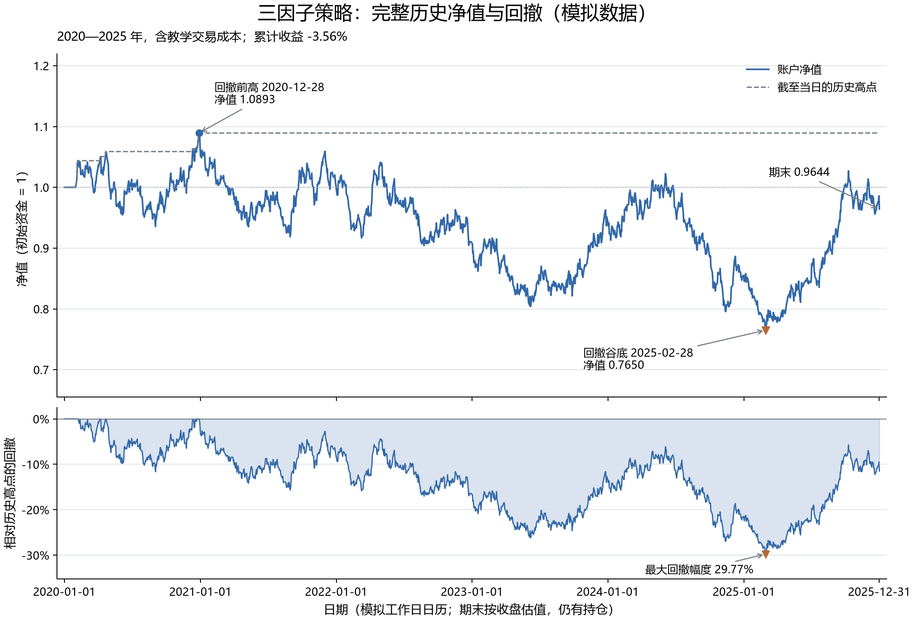

# 第 15 步：我把连续账户扩展到完整历史，并亲自定义四项绩效

<!-- SNAPSHOT_NOTE -->
## 我的数据准备说明

我在本页记录的是完整快照上的实际运行。如果我从 GitHub 克隆源码，我先在仓库根目录运行 `python publication/restore_snapshot.py`，恢复同版本的 `data/` 与 `runs/`，再执行本步。[完整数据与大型结果索引](../../publication/ASSET_INDEX.md)保留全部路径和哈希；本页图表与 Notebook 已保存输出可直接阅读。


## 我的目标与研究范围

我已经在前两步核对首次成交和第二次调仓。本步我沿用相同因子、方向、目标组合与成交规则，把账户从 2020-01-01 连续运行到 2025-12-31，再从已实现的每日账户收益计算累计收益、复合年化收益、年化波动和最大回撤。我不为了让曲线更好看而改参数，也不把一个盈利或亏损数字当作程序正确性的证据。

我在本步使用 40 只人工股票。输入从 2019 年开始，是为了给滚动窗口提供历史；正式账户从 2020 年开始。这个日历使用工作日，包含现实市场假日，所以我称它为模拟历史，不称它为完整 A 股实证。我的图表和表格都保留这一来源限定。

## 我的前置与精确命令

我在仓库根目录使用已安装的独立环境运行：

```powershell
.\.venv\Scripts\python.exe examples/15_full_history_performance.py
```

我的输入是 [固定模拟快照](../../runs/first_demo_20261107/input/metadata.json) 和 [baseline.json](../../configs/baseline.json)。本步脚本重新计算滚动因子并运行核心引擎，不依赖我在终端手工保留的变量。如果第 14 步的 `daily.csv` 存在，脚本会检查重叠区间是否一致。我保留第 14 步作为局部审计样本，防止扩展历史后悄悄改变第一次买入或第二次调仓。

我的主要输出是 [summary.json](../../runs/first_demo_20261107/lesson15_full_backtest/summary.json)、[daily.csv](../../runs/first_demo_20261107/lesson15_full_backtest/daily.csv) 和 [metrics.csv](../../runs/first_demo_20261107/lesson15_full_backtest/metrics.csv)。成交、订单和持仓也与本步一起保存，指标并不是脱离账户记录的独立数字。



我先看图的上半部分：账户净值与截至当日的历史高点；再看下半部分：相对于各自历史高点的回撤。曲线每个点都是收盘估值，期末也仍有持仓，不是强制清仓后的现金。

## 我的每日收益起点为什么不是缺失值

前面单只股票的第一天日收益没有前一价格，保留 `NaN` 是正确做法；本步账户的第一条收益含义不同。我的账户在开始前有已知初始资金 (E_0=1,000,000)，所以第一条收益可以定义为第一收盘权益除以初始资金减一。

本次 2020-01-01 仍为持币状态，权益 100 万、净值 1、日收益 0。首次执行在 2020-02-03，之前共有 23 个模拟持币日，全部属于我已经声明的评价区间。我保留这些零收益日，不以“还没买股票”为由删除它们。删除会改变年化天数、平均收益和波动估计。

我以核心 `daily["return"]` 为权威账户收益，不在切片后重新 `pct_change()` 再把第一行填零。若首日发生费用或亏损，强行置零会直接漏掉这部分损益。本次首行为零只是实际持币结果，不是通用修补规则。

## 我的四个公式与相应代码

### 我先计算累计财富，而不是把简单收益率相加

设每日简单收益率为 (r_t)，我将起始财富设为 1：

$$
W_t=\prod_{u=1}^{t}(1+r_u),\qquad R_{total}=W_T-1.
$$

```python
returns = daily["return"].astype(float)
daily["growth_factor"] = 1 + returns
daily["nav_from_returns"] = daily["growth_factor"].cumprod(skipna=False)
daily["cumulative_return"] = daily["nav_from_returns"] - 1
```

我在第一行明确数值类型，第二行把收益变成财富增长倍数，第三行按时间顺序连乘，第四行转换为累计收益。我用 `skipna=False`，使中途未知收益不会被跳过；脚本还在计算前拒绝缺失、无穷和不大于 -100% 的非法收益。

我同时检查连乘净值等于 `daily.nav`，也等于 `equity / initial_cash`。三种口径的差异只能在浮点尾数范围，不能只因为最终值碰巧相同就忽略中间路径。

### 我使用明确写出的 252 交易日复合年化

我设收益条数为 (N)，一年约定为 252 个交易日：

$$
R_{annual}=W_T^{252/N}-1.
$$

```python
n_days = len(returns)
annual_return = (1 + total_return) ** (annual_sessions / n_days) - 1
```

我本次有 1566 条账户日收益，折合 (1566/252=6.2142857143) 个约定交易年。它不等同于两个日期之间的自然年长度，所以我把结果标为“252 交易日口径复合年化”，而不是混用自然年 CAGR。日收益算术均值乘 252 也不等于这个复合增长率；前者不反映相同的财富连乘结果。

### 我用样本日标准差衡量波动

$$
s_r=\sqrt{\frac{1}{N-1}\sum_{t=1}^{N}(r_t-\bar r)^2},
\qquad \sigma_{annual}=s_r\sqrt{252}.
$$

```python
daily_volatility = returns.std(ddof=1)
annual_volatility = daily_volatility * np.sqrt(annual_sessions)
```

我在第一行明确 `ddof=1`，分母为 (N-1)；第二行采用平方根时间的年化约定。我不会把净值序列的标准差当作日收益波动，也不会把乘 252 与乘 $\sqrt{252}$ 混为一谈。这个年化指标是研究中的统一刻度，不是对任意长周期风险的精确预测。

### 我用截至当日高点计算回撤

$$
H_t=\max(1,W_1,\ldots,W_t),\quad
DD_t=W_t/H_t-1\leq0,\quad MDD=-\min_tDD_t.
$$

```python
daily["running_peak"] = daily["nav_from_returns"].cummax(skipna=False).clip(lower=1.0)
daily["drawdown"] = daily["nav_from_returns"] / daily["running_peak"] - 1
max_drawdown_signed = daily["drawdown"].min()
max_drawdown = -max_drawdown_signed
```

我用 `cummax` 保证高点只来自当前及以前；`clip(lower=1)` 把最初的财富 1 纳入比较。若开局净值跌至 0.9，历史高点仍应为 1，否则会漏掉第一笔 10% 回撤。核心函数保存负的 `max_drawdown`，本课展示正的“回撤幅度”，我同时保留两个字段避免符号混乱。

我不使用 `nav.max()` 作为整段统一分母，因为未来才出现的高点不能成为过去的回撤基准。例如路径 `[1, 0.5, 2]` 的最大回撤是 50%，用未来全局最高 2 衡量中间的 0.5 会错误得到 75%。最大回撤也不是单日收益最低值，连续多天小幅下跌同样能形成较深回撤。

## 我实际得到的四项指标与账户终值

以下数字来自本步保存的 `summary.json`，不是预设目标：

| 我的指标 | 实际模拟输出 |
| --- | ---: |
| 账户日收益条数 | 1566 |
| 累计收益 | -3.5632008619% |
| 252 日口径复合年化收益 | -0.5821523681% |
| 样本日波动率 | 0.8568048424% |
| 年化波动率 | 13.6013552102% |
| 最大回撤幅度 | 29.7749829903% |
| 期末净值 | 0.964367991381 |
| 期末权益 | 964367.9913810544 |
| 期末现金 | 98545.52059094235 |
| 期末股票数量 | 9 |
| 累计经济交易成本 | 93205.4194780295 |
| 有成交的执行日 / 成交笔数 | 71 / 1164 |

我的最深回撤从 2020-12-28 的峰值净值 `1.089308947508`，下降到 2025-02-28 的 `0.764967393675`。我通过谷底之前的切片查找峰值，不能在谷底之后另选更高日期。到期末尚未恢复这个高点，期末回撤约为 -11.4697%；它既不是累计收益 -3.5632%，也不是最大回撤幅度 29.7750%。三个数字使用的比较基准不同。

我最后一次执行发生在 2025-12-01，最后一行只是 2025-12-31 收盘标记。现金与九只股票的市值共同组成终值，我没有加上一笔不存在的末日清仓，也没有收取虚构的退出费用。

## 我如何审计指标背后的账户

我检查 `equity = cash + market_value.sum()` 在每个日期成立，检查现金不为负，检查每笔成交严格晚于对应信号。我还让第 15 步在第 14 步已有的 22 个日期上逐列核对，确认完整运行没有改写早期账户。

我在 `daily.csv` 中保留原始账户列与新增过程列：`growth_factor`、`nav_from_returns`、`cumulative_return`、`running_peak`、`drawdown`。前四项基础列 `nav/cash/equity/return` 可以还原资金和收益，新增列可以逐行解释四指标；我不只保存最终一行汇总。

我也不再次从终值或累计收益中减去 `total_cost`。佣金、税费和滑点已经通过成交价、现金与持仓数量进入账户收益；汇总成本是审计字段，不是等待第二次扣除的账单。

我把期末现金占比也放进解释，而不是只看股票名单。最后的约 9.85 万元现金属于账户资产，既不能从权益中删除，也不能假定它像股票一样产生了收益。本教学引擎没有给现金计息；我若以后加入货币收益，需要明确独立的现金收益规则，而不能在计算年化时临时补上一段利息。

我还区分“完整历史”和“足够可靠的研究结论”。六年模拟长度让程序经历了多次月末与跨年，但价格由固定随机种子生成，缺少真实市场的产业结构、制度演变和可投资性证据。我使用这些数据核对会计、时间和指标，不用较长曲线制造比来源更强的可信度。复合年化是这段已发生模拟路径的统一表达，不是对下一年的收益承诺。

## 我的验收、结论与下一步

我的验收是：正式期间与配置相同；2019 年只作预热；23 个持币日和首行已知收益保留；财富连乘与账户净值一致；年化天数与标准差自由度明确；初始财富参加高点；峰值在谷底之前；期末估值与未清仓状态明确。波动、回撤和收益都能够从过程表复算。

我得到的结论是这个固定模拟策略没有让初始资金增长，而不是“量化无效”或“该因子在 A 股无效”。我接下来需要一个定义清楚、费率相同的基准，并通过重新运行成本档位区分选股结果和交易摩擦的影响。

[我的完整脚本](../../examples/15_full_history_performance.py) · [下一步：基准与成本对照](../16_benchmark_cost_comparison/README.md)

<!-- GENERATED_FULL_SOURCE_START -->

## 我的完整脚本源码

我把本步完整实现保留在 [15_full_history_performance.py](../../examples/15_full_history_performance.py)。精选代码解释在前文，以下代码与脚本文件一致。

```python
r"""第十五课：完整历史回测，逐行计算收益、波动和回撤。

运行：.\.venv\Scripts\python.exe examples/15_full_history_performance.py
输入沿用 first_demo_20261107 的人工行情；不拼入第十四课的人为拒卖场景。
"""

from pathlib import Path

import numpy as np
import pandas as pd
import matplotlib

matplotlib.use("Agg")
import matplotlib.pyplot as plt
import matplotlib.dates as mdates
from matplotlib.ticker import PercentFormatter

from ashare_lab.backtest import metrics, run_backtest
from ashare_lab.config import load_config
from ashare_lab.data import load_dataset, write_json
from ashare_lab.factors import compute_factors


def calculate_performance(daily, initial_cash, annual_sessions=252):
    """返回带计算过程的日表和指标；金额不再重复扣除交易成本。"""
    daily = daily.copy().sort_values("date").reset_index(drop=True)
    if len(daily) < 2 or daily["date"].duplicated().any():
        raise ValueError("至少需要两个不同日期的账户记录。")
    if initial_cash <= 0 or annual_sessions <= 0:
        raise ValueError("初始资金和每年交易日数必须为正。")
    returns = daily["return"].astype(float)
    if not np.isfinite(returns).all() or (returns <= -1).any():
        raise ValueError("日收益缺失或非法；不能填零后继续计算。")

    # A. 净值与累计收益：每一行是账户的已知日收益，包括持币日。
    daily["growth_factor"] = 1 + returns
    daily["nav_from_returns"] = daily["growth_factor"].cumprod(skipna=False)
    daily["cumulative_return"] = daily["nav_from_returns"] - 1
    total_return = daily["cumulative_return"].iloc[-1]

    # B. 复合年化：把 n 个模拟交易日折算成 n / 252 个交易年。
    n_days = len(returns)
    annual_return = (1 + total_return) ** (annual_sessions / n_days) - 1

    # C. 样本日波动率及平方根时间法则下的年化波动率。
    daily_volatility = returns.std(ddof=1)
    annual_volatility = daily_volatility * np.sqrt(annual_sessions)

    # D. 初始净值 1 也参与历史高点，避免漏掉开局亏损。
    daily["running_peak"] = daily["nav_from_returns"].cummax(skipna=False).clip(lower=1.0)
    daily["drawdown"] = daily["nav_from_returns"] / daily["running_peak"] - 1
    max_drawdown_signed = daily["drawdown"].min()
    max_drawdown = -max_drawdown_signed

    # E. 定位最深回撤的谷底，以及谷底之前的历史峰值。
    trough_index = daily["drawdown"].idxmin()
    before_trough = daily.loc[:trough_index]
    peak_index = before_trough["nav_from_returns"].idxmax()
    peak_date = None
    peak_nav = 1.0
    if before_trough.loc[peak_index, "nav_from_returns"] >= 1:
        peak_date = str(before_trough.loc[peak_index, "date"].date())
        peak_nav = float(before_trough.loc[peak_index, "nav_from_returns"])

    # F. 三种口径交叉核对；不把首日收益强行设为零。
    np.testing.assert_allclose(daily["nav_from_returns"], daily["nav"], rtol=0, atol=1e-10)
    np.testing.assert_allclose(daily["nav_from_returns"], daily["equity"] / initial_cash,
                               rtol=0, atol=1e-10)
    core = metrics(daily)
    np.testing.assert_allclose(
        [total_return, annual_return, annual_volatility, max_drawdown_signed],
        [core["total_return"], core["annual_return"], core["annual_volatility"], core["max_drawdown"]],
        rtol=0, atol=1e-10,
    )

    summary = dict(
        source="synthetic teaching data; weekday calendar, not an A-share exchange calendar",
        start=str(daily["date"].iloc[0].date()), end=str(daily["date"].iloc[-1].date()),
        n_days=n_days, annual_sessions=annual_sessions,
        effective_trading_years=float(n_days / annual_sessions),
        initial_cash=float(initial_cash), final_equity=float(daily["equity"].iloc[-1]),
        final_nav=float(daily["nav_from_returns"].iloc[-1]),
        total_return=float(total_return), annual_return=float(annual_return),
        daily_volatility=float(daily_volatility), annual_volatility=float(annual_volatility),
        max_drawdown=float(max_drawdown), max_drawdown_signed=float(max_drawdown_signed),
        drawdown_peak_date=peak_date, drawdown_peak_nav=peak_nav,
        drawdown_trough_date=str(daily.loc[trough_index, "date"].date()),
        drawdown_trough_nav=float(daily.loc[trough_index, "nav_from_returns"]),
        final_drawdown=float(daily["drawdown"].iloc[-1]),
        total_cost=float(daily["cost"].sum()), final_cash=float(daily["cash"].iloc[-1]),
        final_holdings_count=int(daily["holdings_count"].iloc[-1]),
        terminal_valuation="last close; no hypothetical liquidation",
    )
    return daily, summary


def plot_performance(daily, summary, output_path):
    """上方净值、下方回撤，完整展示所有模拟交易日。"""
    plt.rcParams["font.sans-serif"] = ["Microsoft YaHei", "SimHei", "DejaVu Sans"]
    plt.rcParams["axes.unicode_minus"] = False
    plt.rcParams["font.size"] = 11
    fig, (ax_nav, ax_dd) = plt.subplots(
        2, 1, figsize=(11.5, 7.8), sharex=True,
        gridspec_kw={"height_ratios": [2, 1]}, layout="constrained",
    )
    fig.suptitle("三因子策略：完整历史净值与回撤（模拟数据）", fontsize=17)
    ax_nav.set_title(
        f"2020—2025 年，含教学交易成本；累计收益 {summary['total_return']:.2%}",
        loc="left", fontsize=11, pad=12,
    )
    ax_nav.plot(daily["date"], daily["nav_from_returns"], color="#3268A8", linewidth=1.5,
                label="账户净值")
    ax_nav.plot(daily["date"], daily["running_peak"], color="#747D86", linestyle="--",
                linewidth=1.2, label="截至当日的历史高点")
    ax_nav.axhline(1, color="#9FA6AD", linestyle=":", linewidth=0.8)
    ax_nav.set_ylabel("净值（初始资金 = 1）")
    ax_nav.set_ylim(daily["nav_from_returns"].min() - 0.11, daily["nav_from_returns"].max() + 0.13)
    ax_nav.legend(loc="upper right", frameon=False, fontsize=10)
    if summary["drawdown_peak_date"] is not None:
        peak_date = pd.Timestamp(summary["drawdown_peak_date"])
        ax_nav.scatter(peak_date, summary["drawdown_peak_nav"], s=35, color="#3268A8", zorder=5)
        ax_nav.annotate(
            f"回撤前高 {peak_date:%Y-%m-%d}\n净值 {summary['drawdown_peak_nav']:.4f}",
            xy=(peak_date, summary["drawdown_peak_nav"]), xytext=(14, 27), textcoords="offset points",
            fontsize=10, arrowprops={"arrowstyle": "->", "color": "#747D86"},
        )
    trough_date = pd.Timestamp(summary["drawdown_trough_date"])
    ax_nav.scatter(trough_date, summary["drawdown_trough_nav"], marker="v", s=45,
                   color="#B46A31", zorder=5)
    ax_nav.annotate(
        f"回撤谷底 {trough_date:%Y-%m-%d}\n净值 {summary['drawdown_trough_nav']:.4f}",
        xy=(trough_date, summary["drawdown_trough_nav"]), xytext=(-165, -35), textcoords="offset points",
        fontsize=10, arrowprops={"arrowstyle": "->", "color": "#747D86"},
    )
    ax_nav.annotate(
        f"期末 {summary['final_nav']:.4f}", xy=(daily["date"].iloc[-1], summary["final_nav"]),
        xytext=(-100, 30), textcoords="offset points", fontsize=10,
        arrowprops={"arrowstyle": "->", "color": "#747D86"},
    )
    ax_dd.plot(daily["date"], daily["drawdown"], color="#3268A8", linewidth=1.1)
    ax_dd.fill_between(daily["date"], daily["drawdown"], 0, color="#3268A8", alpha=0.18)
    ax_dd.axhline(0, color="#747D86", linewidth=0.8)
    ax_dd.scatter(trough_date, summary["max_drawdown_signed"], marker="v", s=40,
                  color="#B46A31", zorder=5)
    ax_dd.annotate(
        f"最大回撤幅度 {summary['max_drawdown']:.2%}",
        xy=(trough_date, summary["max_drawdown_signed"]), xytext=(-60, -9),
        textcoords="offset points", ha="center", va="top", fontsize=10,
        arrowprops={"arrowstyle": "->", "color": "#747D86"},
    )
    ax_dd.set_ylim(summary["max_drawdown_signed"] - 0.055, 0.025)
    ax_dd.set_ylabel("相对历史高点的回撤")
    ax_dd.yaxis.set_major_formatter(PercentFormatter(xmax=1, decimals=0))
    ticks = pd.date_range(daily["date"].iloc[0], daily["date"].iloc[-1], freq="YS")
    ticks = ticks.union(pd.DatetimeIndex([daily["date"].iloc[0], daily["date"].iloc[-1]]))
    ax_dd.set_xticks(ticks)
    ax_dd.xaxis.set_major_formatter(mdates.DateFormatter("%Y-%m-%d"))
    ax_dd.set_xlim(daily["date"].iloc[0] - pd.Timedelta(days=20),
                   daily["date"].iloc[-1] + pd.Timedelta(days=20))
    ax_dd.set_xlabel("日期（模拟工作日日历；期末按收盘估值，仍有持仓）")
    for ax in (ax_nav, ax_dd):
        ax.grid(axis="y", color="#DCE2E8", linewidth=0.7)
        ax.spines[["top", "right"]].set_visible(False)
        ax.tick_params(axis="both", labelsize=10)
    fig.savefig(output_path, dpi=180)
    plt.close(fig)


def main():
    # 1. 定位项目与输入；不用重新生成数据，不改上一课文件。
    project_dir = Path(__file__).resolve().parents[1]
    run_dir = project_dir / "runs" / "first_demo_20261107"
    prices, universe, calendar, _ = load_dataset(run_dir / "input")

    # 2. 恢复完整区间；2019 年行情保留在 prices 中，只用于滚动历史预热。
    config = load_config(project_dir / "configs" / "baseline.json")
    config["calendar_dates"] = calendar.strftime("%Y-%m-%d").tolist()

    # 3. 沿用同一套因子与成交规则，连续运行 2020-01-01 到 2025-12-31。
    factors = compute_factors(prices, universe, config)
    result = run_backtest(prices, factors, calendar, config)

    # 4. 展开四项指标的计算过程。
    daily, summary = calculate_performance(result.daily, config["initial_cash"])

    # 5. 对账：每日权益包含现金与实际持仓；成交严格晚于信号。
    invested = result.positions.groupby("date")["market_value"].sum()
    stock_values = daily["date"].map(invested).fillna(0)
    np.testing.assert_allclose(daily["equity"], daily["cash"] + stock_values, rtol=0, atol=1e-7)
    assert (daily["cash"] >= 0).all()
    assert (result.trades["date"] > result.trades["signal_date"]).all()
    summary["execution_days_with_trades"] = int(result.trades["date"].nunique())
    summary["trade_count"] = len(result.trades)
    summary["rejected_orders"] = int(result.orders["status"].eq("rejected").sum())

    # 6. 若上一课文件存在，核对重叠区间完全衔接。
    previous_path = run_dir / "lesson14_daily_rebalance" / "daily.csv"
    if previous_path.exists():
        previous = pd.read_csv(previous_path, parse_dates=["date"])
        current = daily.loc[daily["date"].isin(previous["date"]), previous.columns].reset_index(drop=True)
        pd.testing.assert_frame_equal(current, previous, check_exact=False, rtol=0, atol=1e-8)

    # 7. 独立保存本课结果；百分比仍存为小数，显示时才格式化。
    output_dir = run_dir / "lesson15_full_backtest"
    output_dir.mkdir(parents=True, exist_ok=True)
    daily.to_csv(output_dir / "daily.csv", index=False, date_format="%Y-%m-%d")
    for name in ["trades", "orders", "positions"]:
        getattr(result, name).to_csv(output_dir / f"{name}.csv", index=False, date_format="%Y-%m-%d")
    metric_names = ["total_return", "annual_return", "annual_volatility", "max_drawdown"]
    pd.DataFrame([{name: summary[name] for name in metric_names}]).to_csv(output_dir / "metrics.csv", index=False)
    write_json(output_dir / "summary.json", summary)
    write_json(output_dir / "config_snapshot.json", {k: v for k, v in config.items() if k != "calendar_dates"})
    plot_performance(daily, summary, output_dir / "full_history_nav_drawdown.png")

    print("人工行情与工作日日历；2019 年预热，2020—2025 年连续回测。")
    print(f"账户日收益条数：{summary['n_days']}；252 日口径年数：{summary['effective_trading_years']:.6f}")
    print(f"累计收益：{summary['total_return']:.6%}")
    print(f"复合年化收益（252 日口径）：{summary['annual_return']:.6%}")
    print(f"日波动率（样本标准差）：{summary['daily_volatility']:.6%}")
    print(f"年化波动率：{summary['annual_volatility']:.6%}")
    print(f"最大回撤幅度（正数）：{summary['max_drawdown']:.6%}")
    print(f"回撤峰值：{summary['drawdown_peak_date']}，净值 {summary['drawdown_peak_nav']:.9f}")
    print(f"回撤谷底：{summary['drawdown_trough_date']}，净值 {summary['drawdown_trough_nav']:.9f}")
    print(f"期末权益：{summary['final_equity']:,.6f}；期末净值：{summary['final_nav']:.9f}")
    print(f"期末现金：{summary['final_cash']:,.6f}；股票数量：{summary['final_holdings_count']}")
    print(f"有成交的执行日：{summary['execution_days_with_trades']}；成交笔数：{summary['trade_count']}")
    print("本课结果目录：", output_dir)


if __name__ == "__main__":
    main()
```

<!-- GENERATED_FULL_SOURCE_END -->

<!-- GENERATED_NAV_START -->

[项目首页](../../README.md) · [本步 Notebook](lesson.ipynb) · [上一步](../14_daily_valuation_rebalance/README.md) · [下一步](../16_benchmark_cost_comparison/README.md)

<!-- GENERATED_NAV_END -->
