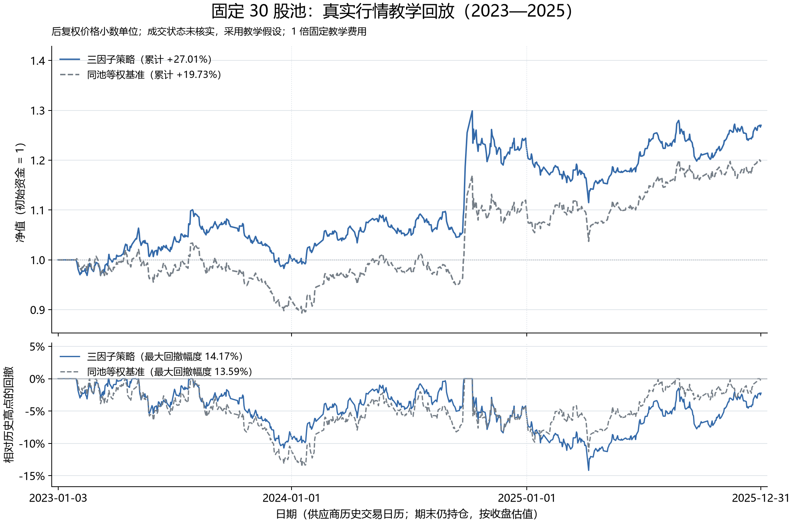

# 第 18 步：真实 A 股快照核对与教学回放

<!-- SNAPSHOT_NOTE -->
## 数据准备说明

本页记录完整快照上的实际运行。通过 GitHub 克隆源码后，先在仓库根目录运行 `python publication/restore_snapshot.py`，恢复同版本的 `data/` 与 `runs/`，再执行本步。[完整数据与大型结果索引](../../publication/ASSET_INDEX.md)保留全部路径和哈希；本页图表与 Notebook 已保存输出可直接阅读。


## 目标：接入真实行情前先核对数据含义

前面的步骤已经用人工数据检验数据、因子、成交与账户链条。本步读取已保存的真实历史快照，逐只核对原价、后复权价格、成交量与换手率单位，检查独立交易日历、固定股票池的缺口和可成交状态，再运行同一研究流水线。

“价格是真实历史观察”不等于“历史订单一定能成交”。当前数据是 30 只手工固定股票的教学池，不是历史全 A 股，也不是可追溯的指数动态成分。成交状态全部未知，回放依赖显式的教学假设。这个限定影响结果解释，需要同时写入图题、方法和账户入口。

## 输入来源、版本与运行命令

数据沿用 [metadata.json](../../data/market_teaching/metadata.json) 记录的来源：AKShare `stock_zh_a_hist` 对接的东方财富历史日线，以及 `tool_trade_date_hist_sina` 保存的交易日历。快照取数版本为 AKShare `1.20.22`，取数时间记录为 `2026-11-02T11:58:38.200292+00:00`。这些是快照的来源记录，不意味着将来版本仍会返回完全相同的数据。

在仓库根目录执行：

```powershell
.\.venv\Scripts\python.exe -m ashare_lab check-data --data data/market_teaching
.\.venv\Scripts\python.exe examples/18_real_market_data.py
```

本步读取现成 CSV，不联网重新下载，也不需要安装 AKShare。环境仍只需此前固定的 NumPy、pandas、Matplotlib 与本项目。直接调用研究入口时，在命令中明确成交假设，并选用新输出目录保留旧实验：

```powershell
.\.venv\Scripts\python.exe -m ashare_lab run --data data/market_teaching --config configs/market_teaching.json --out runs/my_market_replay --allow-unknown-status
```

未指定 `--allow-unknown-status` 时，命令行会在回测前拒绝未知状态。加上它只是接受当前教学假设，不会把源表里的 `status_known=False` 改成 `True`。

前置配置是 [market_teaching.json](../../configs/market_teaching.json)，正式研究期为 2023—2025 年，按年划分开发、验证、测试。更早的 2019—2022 年观察仍用于滚动预热。课内输出在 `runs/lesson18_real_market/`，完整七策略实验在其 `experiment/` 子目录。



图中标明“后复权价格小数单位、成交状态未核实、固定教学费用”。它不是券商成交记录，也不是已验证的实盘曲线。横轴年度分界即使落在元旦，也只是时间刻度，不表示当日一定开市。

## 用哈希核对快照身份

每只股票保留原始与后复权响应各一份，加上日历来源，共 61 个原文件。`verify_source_files` 将文件当前 SHA-256 与 `metadata` 记录逐一比较：

```python
actual = sha256(data_dir / "raw" / name)
if actual != expected:
    raise ValueError("原始快照哈希不一致")
```

第一行计算文件内容标识，第二行阻止不同快照被无声混入。哈希一致只证明本地文件与已保存记录相同，不能证明供应商数据没有错误。标准化四个输入文件的哈希也会记录，并在整条流水线运行后再次比较，确认本次实验没有修改原始观察。

[source_hash_checks.csv](../../runs/lesson18_real_market/source_hash_checks.csv) 显示 61 个文件均匹配。文件名相同不足以证明来源一致；保留原始响应，也有助于追查清洗后结果的来源。

## 逐字段核对价格与单位

规范化表保留原始 `open/high/low/close`，另用 `adj_open/adj_close` 保存供应商 `hfq` 后复权价。代码先让原价、复权价、标准化表的日期索引一一匹配，再比较数值：

```python
expected["adj_open"] = adjusted["开盘"]
expected["adj_close"] = adjusted["收盘"]
expected["volume"] = raw["成交量"] * 100
expected["turnover"] = raw["换手率"] / 100
```

前两行明确收益研究的价格来源；第三行把“手”转为“股”；第四行把百分数换手率转为小数比例。代码 `000001` 必须以六位字符串保存，不能读成整数 1。原价与复权价不能混用计算同一收益区间，否则企业行动引起的尺度变化可能被误当作可交易收益。

[normalization_checks.csv](../../runs/lesson18_real_market/normalization_checks.csv) 覆盖 30 只股票。价格与成交量最大误差均为 0，换手率最大误差约 (9.98\times10^{-17})，属于浮点表达误差。对齐失败或字段明显不一致时应停止，不能用 `fillna` 把表凑齐。

## 区分 43 条完整网格缺口与 37 条 eligible 缺口

全快照有 1699 个市场交易日、30 只固定股票。完整笛卡尔网格应有 (1699\times30=50970) 行，实际价格有 50927 行，少 43 行。现有 `universe` 按每只股票“首个可见行情日”开始标为 eligible，因此其中 6 行没有计入合格池缺口，剩下 37 行才是当前定义下的 eligible 缺口。

这两个数字都需要保存，不能把 37 说成整个固定网格的全部缺口。额外 6 行是 `600030` 在 2019 年 1 月 2、3、4、7、8、9 日；首条观察之前没有数据，也不能据此认定股票尚未上市。上市、IPO 排除与历史资格需要独立证据，当前适配器没有提供。

合格缺口按年为 2019 年 20 行、2021 年 10 行、2022 年 7 行，涉及 `000333/000651/002415/600009/600030`。[missing_fixed_pool_rows.csv](../../runs/lesson18_real_market/missing_fixed_pool_rows.csv) 和 [yearly_coverage.csv](../../runs/lesson18_real_market/yearly_coverage.csv) 保留了具体缺失日期，便于逐行检查。

2023—2025 年共有 727 个来源日历交易日，固定 30 股应有 21810 行，实际也有 21810 行，该段行情缺口为零。覆盖检查在研究区间发现缺行就会停止，不把“没有观察”自动解释成休市或零收益。

## 保留完整真实区间的失败证据

原本按 2020—2025 年运行时，引擎在持有 `600009` 的 2021-06-10 找不到价格行，报出 `Missing held price row`，记录保存在 [failed_2020_2025.json](../../runs/failed_2020_2025.json)。原响应中 2021-06-09 之后的下一条记录为 2021-06-25；这支持“观察存在缺口”，但不足以证明停牌原因与应采用的估值规则已经核实。

这只股票没有被删除，也没有用未来复牌价回填，缺口仍按缺失处理，不作为市场休市。项目记录把正式教学段按覆盖检查冻结为 2023—2025 年，并在更早历史中保留缺口；滚动窗口遇到缺日会无效，不会自动缩成较少观察。

这个范围选择使有限教学回放可以运行，不意味着 2020—2025 年完整真实实证已经完成，也不意味着区间内成交状态已被核实。当前所有年份结果已经可见，本步是已有快照的复现，不是新的未见测试实验。

## 保留未知状态，显式采用教学成交假设

当前快照全部 50927 行 `status_known=False`，所有已观察行成交量大于零，适配器因此将 `can_buy/can_sell` 设为真。研究段 21810 行也全部未知。规范化核对会明确拒绝把这些状态改成已知：

```python
if normalized["status_known"].any():
    raise ValueError("这份快照的成交状态应保持未知")
results, research, metric_table = run_pipeline(
    data_dir, config_path, output_dir / "experiment", allow_unknown_status=True,
)
```

前三行保护源数据语义，后面显式选择教学假设。允许未知状态不会解除缺失持仓价格的硬错误，日线成交量也不能证明开盘盘口能容纳订单。历史 ST、退市、停复牌、板块涨跌停及开盘可成交状态都仍需补充；当前 0 拒单来自标记假设，不代表流动性已经验证。

## 真实行情教学结果

以下数字来自 [strategy_benchmark_metrics.csv](../../runs/lesson18_real_market/strategy_benchmark_metrics.csv)，同为一倍教学费率：

| 结果 | 三因子策略 | 同池等权基准 |
| --- | ---: | ---: |
| 正式账户日数 | 727 | 727 |
| 累计收益 | 27.0063% | 19.7282% |
| 252 日口径复合年化 | 8.6398% | 6.4401% |
| 年化波动 | 11.7409% | 12.3023% |
| 最大回撤幅度 | 14.1726% | 13.5898% |
| 期末权益 | 1270062.7651 | 1197282.2620 |
| 累计经济成本 | 47889.0106 | 2129.0505 |
| 成交笔数 | 549 | 1050 |

策略终值比基准多约 6.0788%，累计收益差为 7.2781 个百分点。2025 年策略累计约 3.3587%，基准约 8.0429%，策略在该年相对落后约 4.3355%。解读时，我不会只摘取全段相对领先而省略这一年。

两个账户从 2023-01-03 的现金净值 1 开始，首次买入为 2023-02-01，最后执行为 2025-12-01，最后一天仍分别有 10 只和 30 只股票。本引擎用后复权价格小数单位表达经济收益，不另行建立企业行动现金流与原始股数账，也没有整手、最低佣金、容量冲击和历年税费表。真实数据并没有自动使这些教学简化消失。

## 验收、结论与交付入口

[accounting_audit.csv](../../runs/lesson18_real_market/accounting_audit.csv) 核对七条策略路径：每日现金加持仓等于权益、收益连乘等于净值、费用合计对应逐笔成交、所有成交晚于信号。最大权益恒等式误差约 (2.33\times10^{-10}) 元，不影响经济解释。[完整研究报告](../../runs/lesson18_real_market/experiment/report.html)、[数据质量](../../runs/lesson18_real_market/data_quality.json)和[方法边界](../../runs/lesson18_real_market/methodology.json)也一并保留，使收益图可以回到具体数据与假设。

本步表明，同一工程已经接入这份真实固定股票池快照，并能在明确假设下复现。固定幸存者与选择偏差、未知历史成交条件和不完整企业行动账仍限制研究外推。下一步整理代码、课程、数据、失败记录、测试和结果，使“可以重新运行”和“哪些尚未完成”都能检查。

[完整脚本](../../examples/18_real_market_data.py) · [下一步：复现验收与交付](../19_finalize_project/README.md)

<!-- GENERATED_FULL_SOURCE_START -->

## 完整脚本源码

完整实现见 [18_real_market_data.py](../../examples/18_real_market_data.py)。上文解释关键片段，以下代码与脚本文件一致。

```python
r"""第十八课：真实 A 股快照接入、数据核对与教学成交回放。

运行：.\.venv\Scripts\python.exe examples/18_real_market_data.py
复现已保存的真实历史快照；行情完整不等于历史成交状态已经核实。
"""

from pathlib import Path

import numpy as np
import pandas as pd
import matplotlib

matplotlib.use("Agg")
import matplotlib.pyplot as plt
import matplotlib.dates as mdates
from matplotlib.ticker import PercentFormatter

from ashare_lab.cli import run_pipeline
from ashare_lab.config import load_config
from ashare_lab.data import data_quality, load_dataset, sha256, write_json


def verify_source_files(data_dir, metadata):
    """原始响应哈希匹配只证明快照未变，不证明供应商数据绝对正确。"""
    rows = []
    for name, expected in metadata["source_files"].items():
        actual = sha256(data_dir / "raw" / name)
        rows.append(dict(file=name, expected_sha256=expected, actual_sha256=actual, matches=actual == expected))
    checks = pd.DataFrame(rows)
    if checks.empty or not checks["matches"].all():
        raise ValueError("原始响应与 metadata 中保存的哈希不一致，停止复现。")
    return checks


def verify_normalization(data_dir, prices, metadata):
    """逐只复核原价、后复权价及单位转换，保留六位字符串代码。"""
    checks = []
    for symbol in metadata["symbols"]:
        raw = pd.read_csv(data_dir / "raw" / f"{symbol}_raw.csv",
                          dtype={"股票代码": str}, parse_dates=["日期"]).set_index("日期").sort_index()
        adjusted = pd.read_csv(data_dir / "raw" / f"{symbol}_hfq.csv",
                               dtype={"股票代码": str}, parse_dates=["日期"]).set_index("日期").sort_index()
        normalized = prices.loc[prices["symbol"].eq(symbol)].set_index("date").sort_index()
        pd.testing.assert_index_equal(raw.index, adjusted.index, check_names=False)
        pd.testing.assert_index_equal(raw.index, normalized.index, check_names=False)

        expected = pd.DataFrame(index=raw.index)
        for english, chinese in [("open", "开盘"), ("high", "最高"), ("low", "最低"), ("close", "收盘")]:
            expected[english] = raw[chinese]
        expected["adj_open"] = adjusted["开盘"]
        expected["adj_close"] = adjusted["收盘"]
        expected["volume"] = raw["成交量"] * 100
        expected["turnover"] = raw["换手率"] / 100
        np.testing.assert_allclose(normalized[expected.columns], expected, rtol=0, atol=1e-8)
        np.testing.assert_array_equal(normalized["can_buy"], normalized["volume"] > 0)
        np.testing.assert_array_equal(normalized["can_sell"], normalized["volume"] > 0)
        if normalized["status_known"].any():
            raise ValueError("这份快照的成交状态应保持未知；不能伪装成已核实。")
        errors = (normalized[expected.columns] - expected).abs().max()
        checks.append(dict(symbol=symbol, rows=len(normalized), raw_adjusted_dates_match=True,
                           max_price_error=float(errors[["open", "high", "low", "close", "adj_open", "adj_close"]].max()),
                           max_volume_error=float(errors["volume"]), max_turnover_error=float(errors["turnover"])))
    return pd.DataFrame(checks)


def inspect_coverage(prices, universe, calendar, metadata, config):
    """同时报告全笛卡尔缺口与当前 eligible 定义下的缺口。"""
    full_grid = pd.MultiIndex.from_product([calendar, metadata["symbols"]],
                                            names=["date", "symbol"]).to_frame(index=False)
    coverage = full_grid.merge(universe, on=["date", "symbol"], how="left", validate="one_to_one")
    if coverage["eligible"].isna().any():
        raise ValueError("股票池定义缺少日期/股票记录，不能默认为合格。")
    coverage = coverage.merge(prices[["date", "symbol"]], on=["date", "symbol"],
                               how="left", validate="one_to_one", indicator=True)
    coverage["missing"] = coverage["_merge"].eq("left_only")
    coverage["missing_eligible"] = coverage["missing"] & coverage["eligible"]
    coverage["in_study"] = coverage["date"].between(config["start"], config["end"])
    missing = coverage.loc[coverage["missing"], ["date", "symbol", "eligible", "in_study"]].copy()
    yearly = coverage.assign(year=coverage["date"].dt.year).groupby("year").agg(
        expected_fixed_pool_rows=("symbol", "size"), eligible_rows=("eligible", "sum"),
        missing_fixed_pool_rows=("missing", "sum"), missing_eligible_rows=("missing_eligible", "sum"),
    ).reset_index()
    study = coverage.loc[coverage["in_study"]]
    if study["missing"].any():
        raise ValueError("既定研究区间存在股票/日期行情缺口，停止；不填价后继续。")
    if not study["eligible"].all():
        raise ValueError("本课既定区间应完整覆盖固定教学池，请先核对资格定义。")
    return missing, yearly, int(len(study))


def audit_results(results, output_dir):
    rows = []
    for name, result in results.items():
        daily = result.daily
        invested = result.positions.groupby("date")["market_value"].sum()
        error = daily["equity"] - daily["cash"] - daily["date"].map(invested).fillna(0)
        np.testing.assert_allclose(error, 0, rtol=0, atol=1e-7)
        assert (daily["cash"] >= 0).all()
        assert (result.trades["date"] > result.trades["signal_date"]).all()
        np.testing.assert_allclose((1 + daily["return"]).cumprod(skipna=False), daily["nav"], rtol=0, atol=1e-10)
        np.testing.assert_allclose(daily["cost"].sum(),
                                   result.trades[["commission", "tax", "slippage_cost"]].sum().sum(),
                                   rtol=0, atol=1e-7)
        rows.append(dict(strategy=name, daily_rows=len(daily), trade_count=len(result.trades),
                         max_equity_identity_error=float(error.abs().max()),
                         rejected_orders=int(result.orders["status"].eq("rejected").sum()),
                         fills_after_signal=True, costs_reconcile=True))
    pd.DataFrame(rows).to_csv(output_dir / "accounting_audit.csv", index=False)


def plot_market(results, output_path):
    """展示行情驱动的教学回放；不将假设成交标成已验证的实际成交。"""
    plt.rcParams["font.sans-serif"] = ["Microsoft YaHei", "SimHei", "DejaVu Sans"]
    plt.rcParams["axes.unicode_minus"] = False
    plt.rcParams["font.size"] = 11
    fig, (ax_nav, ax_dd) = plt.subplots(2, 1, figsize=(11.5, 7.6), sharex=True,
                                       gridspec_kw={"height_ratios": [2, 1]}, layout="constrained")
    fig.suptitle("固定 30 股池：真实行情教学回放（2023—2025）", fontsize=17)
    ax_nav.set_title("后复权价格小数单位；成交状态未核实，采用教学假设；1 倍固定教学费用",
                     loc="left", fontsize=10, pad=12)
    nav_min, nav_max, dd_min = 1.0, 1.0, 0.0
    for key, color, line, label in [("multifactor", "#3268A8", "-", "三因子策略"),
                                     ("benchmark", "#747D86", "--", "同池等权基准")]:
        daily = results[key].daily
        peak = daily["nav"].cummax(skipna=False).clip(lower=1)
        drawdown = daily["nav"] / peak - 1
        ax_nav.plot(daily["date"], daily["nav"], color=color, linestyle=line, linewidth=1.5,
                     label=f"{label}（累计 {daily['nav'].iloc[-1] - 1:+.2%}）")
        ax_dd.plot(daily["date"], drawdown, color=color, linestyle=line, linewidth=1.3,
                    label=f"{label}（最大回撤幅度 {-drawdown.min():.2%}）")
        nav_min = min(nav_min, daily["nav"].min())
        nav_max = max(nav_max, daily["nav"].max())
        dd_min = min(dd_min, drawdown.min())
    ax_nav.set_ylim(nav_min - 0.04, nav_max + 0.13)
    ax_nav.axhline(1, color="#9FA6AD", linewidth=0.8, linestyle=":")
    ax_nav.set_ylabel("净值（初始资金 = 1）")
    ax_dd.set_ylim(dd_min - 0.025, 0.055)
    ax_dd.axhline(0, color="#9FA6AD", linewidth=0.8)
    ax_dd.set_ylabel("相对历史高点的回撤")
    ax_dd.yaxis.set_major_formatter(PercentFormatter(xmax=1, decimals=0))
    dates = results["multifactor"].daily["date"]
    # 显示首尾和年度分界；元旦刻度只是时间轴标签，不表示当天开市。
    ticks = pd.DatetimeIndex([dates.iloc[0], pd.Timestamp("2024-01-01"),
                              pd.Timestamp("2025-01-01"), dates.iloc[-1]])
    ax_dd.set_xticks(ticks)
    ax_dd.xaxis.set_major_formatter(mdates.DateFormatter("%Y-%m-%d"))
    ax_dd.set_xlim(dates.iloc[0] - pd.Timedelta(days=10), dates.iloc[-1] + pd.Timedelta(days=10))
    ax_dd.set_xlabel("日期（供应商历史交易日历；期末仍持仓，按收盘估值）")
    for ax in (ax_nav, ax_dd):
        ax.legend(loc="upper left", frameon=False, fontsize=10)
        ax.grid(axis="y", color="#DCE2E8", linewidth=0.7)
        ax.spines[["top", "right"]].set_visible(False)
        for boundary in [pd.Timestamp("2024-01-01"), pd.Timestamp("2025-01-01")]:
            ax.axvline(boundary, color="#DCE2E8", linewidth=0.8, linestyle=":")
    fig.savefig(output_path, dpi=180)
    plt.close(fig)


def main():
    project_dir = Path(__file__).resolve().parents[1]
    data_dir = project_dir / "data" / "market_teaching"
    config_path = project_dir / "configs" / "market_teaching.json"
    output_dir = project_dir / "runs" / "lesson18_real_market"
    output_dir.mkdir(parents=True, exist_ok=True)

    # 1. 使用已保存的真实原始响应与规范化快照，保留取数日期和版本。
    prices, universe, calendar, metadata = load_dataset(data_dir)
    config = load_config(config_path)
    if metadata["kind"] != "market_teaching_pool":
        raise ValueError("本课需要真实行情教学池。")
    input_hashes = {name: sha256(data_dir / name) for name in ["prices.csv", "universe.csv", "calendar.csv", "metadata.json"]}
    source_checks = verify_source_files(data_dir, metadata)
    normalization_checks = verify_normalization(data_dir, prices, metadata)

    # 2. 核对独立保存的供应商历史日历，不用普通工作日生成交易日历。
    raw_calendar = pd.read_csv(data_dir / "raw" / "calendar_source.csv", parse_dates=["trade_date"])
    source_calendar = pd.DatetimeIndex(raw_calendar["trade_date"])
    source_calendar = source_calendar[(source_calendar >= pd.Timestamp(metadata["requested_start"])) &
                                       (source_calendar <= pd.Timestamp(metadata["requested_end"]))].sort_values().unique()
    pd.testing.assert_index_equal(calendar, source_calendar, check_names=False)

    # 3. 沿用此前已冻结的 2023—2025 年区间，先查覆盖，再计算绩效。
    missing, yearly, expected_study_rows = inspect_coverage(prices, universe, calendar, metadata, config)
    quality = data_quality(prices, universe, calendar, metadata)
    study_prices = prices.loc[prices["date"].between(config["start"], config["end"])]
    study_calendar = calendar[(calendar >= pd.Timestamp(config["start"])) & (calendar <= pd.Timestamp(config["end"]))]
    quality.update(dict(full_fixed_grid_rows=len(calendar) * len(metadata["symbols"]),
                        full_fixed_grid_missing_rows=len(missing),
                        study_start=config["start"], study_end=config["end"],
                        study_sessions=len(study_calendar), study_price_rows=len(study_prices),
                        expected_study_rows=expected_study_rows, missing_eligible_rows_in_study=0,
                        unknown_status_rows_in_study=int((~study_prices["status_known"]).sum()),
                        verified_raw_files=len(source_checks)))
    write_json(output_dir / "data_quality.json", quality)
    source_checks.to_csv(output_dir / "source_hash_checks.csv", index=False)
    normalization_checks.to_csv(output_dir / "normalization_checks.csv", index=False)
    missing.to_csv(output_dir / "missing_fixed_pool_rows.csv", index=False, date_format="%Y-%m-%d")
    yearly.to_csv(output_dir / "yearly_coverage.csv", index=False)
    prices.loc[prices["symbol"].eq("000001")].head(6).to_csv(output_dir / "sample_000001.csv", index=False, date_format="%Y-%m-%d")
    print(f"预检通过：{len(prices)} 行、{prices['symbol'].nunique()} 股；研究区间 {len(study_calendar)} 日、{len(study_prices)} 行。", flush=True)
    print(f"完整固定池缺口 {len(missing)}，其中 eligible 缺口 {quality['missing_eligible_rows']}；研究区间缺口 0。", flush=True)
    print("成交状态未核实，下面显式采用教学成交假设；原始 status_known 保持 False。", flush=True)

    # 4. 同一条研究流水线：因子、IC/分组、基准/策略/成本、SQLite 与报告。
    results, research, metric_table = run_pipeline(
        data_dir, config_path, output_dir / "experiment", allow_unknown_status=True,
    )

    # 5. 核对账户和输入快照，保存主要结果与边界。
    audit_results(results, output_dir)
    assert input_hashes == {name: sha256(data_dir / name) for name in input_hashes}
    selected = metric_table.loc[metric_table["strategy"].isin(["multifactor", "benchmark"])].copy()
    selected["max_drawdown_amplitude"] = -selected["max_drawdown"]
    selected.to_csv(output_dir / "strategy_benchmark_metrics.csv", index=False)
    write_json(output_dir / "methodology.json", dict(
        data_source=metadata["source"], retrieved_at_utc=metadata["retrieved_at_utc"],
        stored_akshare_version=metadata["akshare_version"], symbols=metadata["symbols"],
        study_config=str(config_path), study_start=config["start"], study_end=config["end"],
        snapshot_input_sha256=input_hashes,
        coverage=dict(full_fixed_grid_missing_rows=len(missing),
                      missing_eligible_rows=quality["missing_eligible_rows"],
                      missing_eligible_rows_in_study=quality["missing_eligible_rows_in_study"]),
        eligibility="starts at first observed source row, not independently verified listing/IPO eligibility",
        execution="allow_unknown_status=True; volume-positive assumed can_buy/can_sell, not verified historical open tradability",
        universe="30 manually fixed selected survivors, not historical A-share population or index members",
        adjustment="provider hfq open and close directly; fractional adjusted units, not exchange share ledger",
        evaluation="replication of already-viewed snapshot and fixed years, not a new untouched holdout",
        fees="fixed teaching assumptions, not a historical tax/fee schedule",
        prior_failure="2020-2025 attempt stopped: missing held price 600009 on 2021-06-10; see runs/failed_2020_2025.json",
        terminal_valuation="last close, without hypothetical liquidation",
        official_api_reference="https://github.com/akfamily/akshare/blob/main/docs/data/stock/stock_quote.md",
    ))
    plot_market(results, output_dir / "real_market_nav_drawdown.png")
    print("\n策略与基准结果（收益以小数存储；max_drawdown_amplitude 为正幅度）：")
    print(selected[["strategy", "split", "n_days", "total_return", "annual_return",
                    "annual_volatility", "max_drawdown_amplitude", "relative_return"]].to_string(index=False))
    print("\n本课结果目录：", output_dir)


if __name__ == "__main__":
    main()
```

<!-- GENERATED_FULL_SOURCE_END -->

<!-- GENERATED_NAV_START -->

[项目首页](../../README.md) · [本步 Notebook](lesson.ipynb) · [上一步](../17_split_stability/README.md) · [下一步](../19_finalize_project/README.md)

<!-- GENERATED_NAV_END -->
